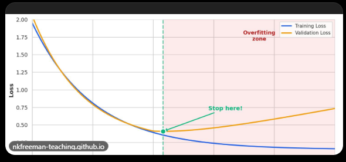
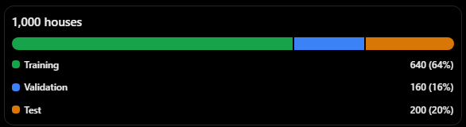
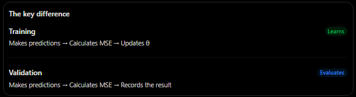
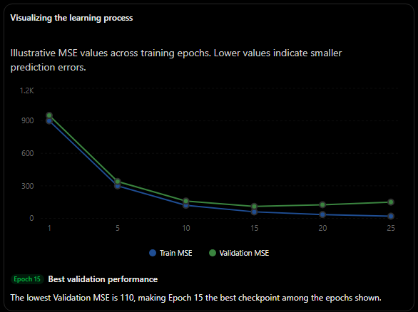
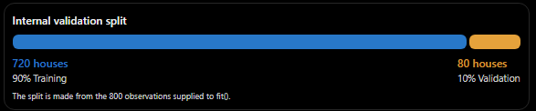
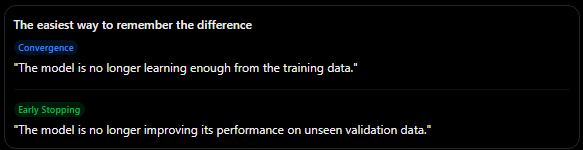

# Early Stopping

Early Stopping is a regularization technique that prevents a model from overfitting by stopping training when performance on the validation set stops improving.

Instead of modifying the cost function or adding a penalty term, it controls how long the model trains.

Supported by:

- Scikit-learn
- XGBoost
- LightGBM
- CatBoost
- Keras

## Monitoring Validation Performance and Stopping at the Optimal Point

Early Stopping is a regularization technique used in iterative training algorithms, such as gradient descent, neural networks, and boosting.

The main idea is to monitor the model's performance on a validation set after each training iteration (or epoch) and stop when validation performance no longer improves.

### Ridge, Lasso, and Elastic Net

These regularization methods modify the cost function by adding a penalty that discourages excessively large model weights.

\\[ \text{Cost} = \text{MSE} + \alpha \times \text{Penalty} \\]

- Ridge (L2): Penalizes large weights by adding the sum of their squared values.
- Lasso (L1): Penalizes large weights by adding the sum of their absolute values.
- Elastic Net: Combines L1 and L2 penalties.

### Early Stopping

Early Stopping achieves a similar regularization effect through a different mechanism: it limits the number of training iterations.

- The model trains normally without modifying its cost function.
- Its performance is evaluated on a validation set.
- Training stops when validation performance stops improving for a specified number of iterations.

The training objective remains unchanged, but the model is prevented from training long enough to start memorizing noise in the training data.

Common applications:

- Gradient descent
- Neural networks
- Gradient boosting

### Understanding the Error vs. Epoch Graph

 

- Training error: Usually continues decreasing as the model learns the training data.
- Validation error: Initially decreases as the model learns useful patterns, but eventually starts increasing when overfitting occurs.
- Optimal stopping point: The epoch where validation error reaches its minimum.

## The Problem: Predicting House Prices Based on Square Footage

Imagine we have a dataset containing 1,000 houses, including their actual selling prices (in millions).

We want to train a machine learning model to predict house prices using square footage.

Input feature (X): Square footage, ranging from 40 to 200.

Target (y): Actual house price, measured in millions.

### Understanding the Relationship

Generally, larger houses tend to have higher prices. This is the underlying pattern we want the model to learn because it helps predict prices for other houses.

However, some houses may have unusually high selling prices due to exceptional circumstances, such as luxury features, special locations, or unusual transactions.

These observations may introduce noise or outliers into the dataset. Not every unusual price represents a general relationship between square footage and house prices.

### What Happens When We Train for Too Long?

A highly flexible model may initially learn the general relationship between house size and price.

However, if training continues for too long, it may start adapting to individual outliers and random fluctuations in the training data instead of learning patterns that generalize to new houses.

This is called overfitting.

Early Stopping helps prevent this by monitoring validation error and stopping training before the model begins to memorize noise.

---

# Data Splitting

Data splitting is the process of dividing a dataset into separate subsets, each with a specific purpose: training, validation, and testing.

The test set is separated first and kept untouched until the final evaluation. The remaining data is then divided into training and validation sets.

### Example: 1,000 Houses

Suppose we have a dataset containing 1,000 houses.



- Test set: 200 houses (20%) — Set aside and kept untouched until the final evaluation.
- Remaining data: 800 houses (80%)
  - Training set: 640 houses (80% of the remaining data) — Used to train the model.
  - Validation set: 160 houses (20% of the remaining data) — Used to monitor performance and determine when to stop training through Early Stopping.

## Three Roles

Each dataset has a specific purpose during the model development process.

The three subsets remain the same across all epochs. What changes during training are the model's parameters $(\theta)$ and, consequently, its predictions.

### 1. Training Set: 640 Houses (Learning)

The training set is where the model learns patterns from the data.

- Gradient descent uses these houses to calculate gradients and update the model's parameters $(\theta)$.
- The training loss, typically measured using Mean Squared Error (MSE), is the objective the model tries to minimize.
- As training progresses, the training loss generally decreases.

> Usage: Used during every training epoch to update the model's parameters.

### 2. Validation Set: 160 Houses (Monitoring)

The validation set is used to evaluate how well the model performs on data that was not used to update its parameters.

- The model makes predictions using these houses, and the resulting validation loss is calculated.
- This loss is monitored after each epoch to track the model's ability to generalize to unseen data.
- Early Stopping uses validation performance to determine when training should stop.
- The validation set does not directly participate in gradient calculations or parameter updates.

> Usage: Evaluated after every epoch to monitor performance and guide training decisions. It does not directly update the model's parameters.

### 3. Test Set: 200 Houses (Final Evaluation)

The test set provides an unbiased estimate of how well the final model performs on previously unseen data.

- It is kept separate throughout training and model selection.
- It is not used for gradient descent, validation monitoring, or Early Stopping.
- Once training and model selection are complete, the final model is evaluated using the test set.
- Its results provide an estimate of how well the model may perform on new, unseen houses.

> Usage: Evaluated at the very end, ideally only once, after all model decisions have been finalized.

## What Happens Across Epochs?

The same 640 training houses and 160 validation houses are used throughout training. The 200 test houses remain untouched.

The model's parameters $(\theta)$ change as gradient descent updates them using the training data. Consequently, its predictions and errors also change.

| Component                       | Changes between epochs? |
| ------------------------------- | ----------------------- |
| Training data (640)             | No                      |
| Validation data (160)           | No                      |
| Test data (200)                 | No                      |
| Model parameters $(\theta)$     | Yes                     |
| Model predictions               | Yes                     |
| Training loss                   | Yes                     |
| Validation loss                 | Yes                     |

Key distinction: The training set teaches the model, the validation set helps monitor and select the model, and the test set evaluates its final performance.

---

## How We Measure Error

### MSE (Mean Squared Error): One formula, three different datasets

Mean Squared Error (MSE) measures how far a model's predictions are from the actual values by calculating the average of the squared differences between them.

$MSE = \frac{1}{n}\sum\_{i=1}^{n}(y_i-\hat{y}\_i)^2$

Where:

- $(y_i)$: Actual value (e.g., the real house price).
- $(\hat{y}\_i)$: Predicted value produced by the model.
- $(n)$: Number of observations (e.g., houses).
- $(\sum)$: Sum of all squared prediction errors.

### Example: Calculating MSE

Suppose a model makes predictions for three houses in the validation set:

| House | Area (m²) | Actual Price | Predicted Price | Squared Error |
| ----- | --------- | ------------ | --------------- | ------------- |
| A     | 50        | 150          | 160             | 100           |
| B     | 80        | 240          | 230             | 100           |
| C     | 100       | 310          | 300             | 100           |

Step 1: Calculate the squared error for each house.

$(150-160)^2=100$

$(240-230)^2=100$

$(310-300)^2=100$

Step 2: Calculate the average of the squared errors.

$MSE\_{validation}=\frac{100+100+100}{3}=100$

Result: 100

The model's Mean Squared Error on these three validation houses is 100.

### The Three Types of MSE

The MSE formula never changes. What changes is the dataset used to calculate it.

| Metric    | Dataset               | Purpose                                                                                                                                                                |
| --------- | --------------------- | ---------------------------------------------------------------------------------------------------------------------------------------------------------------------- |
| MSE_train | 640 training houses   | Measures training error. Gradient Descent (GD) minimizes this value by adjusting the model's parameters $(\theta)$.                                                |
| MSE_val   | 160 validation houses | Measures how well the model performs on unseen validation data. It helps evaluate and select models or tune hyperparameters. It does not directly update $(\theta)$. |
| MSE_test  | 200 test houses       | Measures the model's final performance on unseen data. It is calculated after model selection and tuning are complete.                                                 |

### Key Takeaways

- MSE_train: Used to optimize the model's parameters through Gradient Descent.
- MSE_val: Used to evaluate and improve model selection during development.
- MSE_test: Used to estimate how well the final model generalizes to new, unseen data.

Important: The validation and test datasets must not be used to directly train the model. The test set should remain untouched until the final evaluation to avoid data leakage and overly optimistic performance estimates.

---

## Within an Epoch

### Training adjusts the model's parameters $(\theta)$; validation only measures performance

An epoch is one complete pass through the entire training dataset.

In our example, we have 800 houses divided into three datasets:

- 640 training houses (80%): Used to train the model.
- 160 validation houses (20%): Used to evaluate the model during training.
- 200 test houses: Reserved for the final evaluation (assuming a separate test set).

During each epoch, the following happens:

1\. Training: The model learns

- The model makes predictions for the 640 training houses.
- It calculates the Training MSE to measure its prediction errors.
- Gradient Descent (GD) uses this error to adjust the model's parameters $(\theta)$.
- The goal is to reduce the prediction error by finding better parameter values.

2\. Validation: The model is evaluated

- The model uses its current parameters $(\theta)$ to make predictions for the 160 validation houses.
- It calculates the Validation MSE to measure how well it performs on data it has not trained on.
- The result is recorded, but Gradient Descent does not use it to update the parameters.

3\. The next epoch begins

The model repeats the process using the updated parameters. Training continues, while validation helps monitor whether the model is improving its ability to generalize to unseen data.

 

## What Happens as Epochs Progress?

### Both errors decrease initially, but Validation MSE starts increasing after Epoch 15

As training progresses, the model generally becomes better at predicting the training data. However, this does not necessarily mean it is becoming better at predicting new, unseen data.

Consider the following example:

| Epoch | Train MSE | Validation MSE |
| ----- | --------- | -------------- |
| 1     | 900       | 950            |
| 5     | 300       | 340            |
| 10    | 120       | 160            |
| 15    | 60        | 110 (minimum)  |
| 20    | 35        | 125            |
| 25    | 20        | 150            |

### Understanding the results

Epochs 1–15: The model is learning

- Training MSE decreases from 900 to 60.
- Validation MSE decreases from 950 to 110.
- Both errors improve, meaning the model is learning patterns that also help it make predictions on unseen data.

Epochs 15–25: Overfitting begins

- Training MSE continues decreasing from 60 to 20.
- Validation MSE increases from 110 to 150.
- The model keeps improving on the training data but becomes worse at predicting unseen data.

This is a sign of overfitting: the model starts learning details and noise specific to the training data instead of capturing patterns that generalize well.

 

### What should we do?

Use Early Stopping.

Early Stopping is a technique that monitors Validation MSE during training and stops the process when validation performance stops improving.

In this example:

- Best epoch: 15
- Minimum Validation MSE: 110
- Training should stop when validation performance no longer improves, according to a chosen patience setting.
- Restore the model parameters from Epoch 15 rather than keeping the parameters from Epoch 25.

### Key Takeaways

- Training MSE tells us how well the model fits the training data.
- Validation MSE tells us how well the model performs on unseen validation data.
- If both decrease, the model is generally learning useful patterns.
- If Training MSE decreases while Validation MSE increases, overfitting may be occurring.
- The best model is not necessarily the one with the lowest Training MSE. It is often the one with the best Validation MSE.

Remember: A model that memorizes the training data is not necessarily a model that makes good predictions on new data.

---

## What the Model Learns

### The model starts fitting noise instead of learning general patterns

A machine learning model should learn the underlying relationship between input features and the target variable.

In our house-price example:

- Real pattern: Larger houses generally have higher prices. This relationship is useful because it also applies to new houses.
- Noise: Some houses have unusually high or low prices for reasons that are not explained by their features. These unusual observations may be random or specific to the training dataset.
- Overfitting: A flexible model may start adapting to these unusual observations instead of learning only the underlying relationship.

For example, imagine that some 70 m² houses in the training dataset have unusually high prices.

A model that overfits might learn a rule similar to:

"70 m² houses should have extremely high prices."

However, this relationship may not exist in the real housing market. It may simply be an accidental pattern in the training data.

Why does this matter?

- Training error decreases because the model becomes better at fitting the specific training observations.
- Validation error may increase because the model has learned patterns that do not apply consistently to unseen houses.

The model is no longer just learning the real relationship between house size and price; it is also fitting random variations in the training data.

## Final Evaluation

### The reported performance comes from the test set, evaluated only after model selection

The purpose of the test set is to provide an independent estimate of how well the final model performs on previously unseen data.

Consider the following example:

The final model:

- Best epoch: Epoch 15, using the parameters (\\(\theta\\)) saved at that point.
- Training set: Used to learn the model's parameters.
- Validation set: Used to monitor performance and select the best epoch.
- Test set: 200 houses that have not influenced training or model selection.

The final metric:

$MSE\_{test} = \text{Performance on the 200 test houses}$

### Why isn't Validation MSE sufficient?

Suppose the best Validation MSE is 110 at Epoch 15.

This value is useful, but there is an important limitation:

We repeatedly evaluate the model on the validation set while making decisions about training, hyperparameters, and model selection.

Eventually, our decisions become indirectly influenced by how well the model performs on those particular 160 houses.

This can introduce validation overfitting, also called model-selection bias.

> Validation MSE can be slightly optimistic because we selected the model based partly on its performance on that same dataset.

### Why is the Test MSE different?

The test set is kept separate from the entire model-development process.

Its purpose is to provide an independent evaluation after all decisions have been made.

- It does not influence the model's parameters $(\theta)$.
- It does not determine the stopping epoch.
- It does not influence hyperparameter tuning or model selection.
- It is evaluated only after the final model has been selected.

> The test set provides a more neutral estimate of how the model may perform on new, unseen houses.

### Evidence: Results from our experiment

Using a flexible model and selecting the best-performing epoch:

| Metric                                   | MSE   |
| ---------------------------------------- | ----- |
| Best Validation MSE                      | 1.359 |
| Test MSE (same model)                    | 1.561 |
| Test MSE (final epoch, without stopping) | 1.972 |

The Test MSE is approximately 15% higher than the Validation MSE.

$\frac{1.561-1.359}{1.359}\times100 \approx14.9\%$

This illustrates why validation performance can be optimistic: the model was selected using the validation set, but its performance on the independent test set was slightly worse.

The final-epoch result also illustrates the potential cost of continuing training after the model's generalization performance has started to deteriorate.

Note: These are illustrative experimental results, not universal percentages. A higher test error is common, but it is not guaranteed.

### An important rule: Never use the test set to make model decisions

If you use the test set to select the best epoch, tune hyperparameters, compare models, or make other development decisions, it is no longer an independent test set.

It effectively becomes another validation set.

You would then need a new, untouched test set to obtain an independent final evaluation.

## How It Works in Practice

### The validation curve is noisy: Early Stopping does not react to every upward movement

In real machine learning experiments, Validation MSE does not necessarily decrease smoothly.

It may fluctuate from one epoch to another due to factors such as:

- Randomness in training.
- Mini-batch sampling.
- Changes in model parameters.
- Variations in the validation observations.

For example:

| Epoch | Validation MSE | Interpretation             |
| ----- | -------------- | -------------------------- |
| 1     | 200            | Initial performance        |
| 2     | 150            | Improvement                |
| 3     | 130            | Improvement                |
| 4     | 135            | Temporary increase         |
| 5     | 125            | New best                   |
| 6     | 128            | Small increase             |
| 7     | 120            | New best                   |
| 8     | 123            | Small increase             |
| 9     | 121            | No significant improvement |
| 10    | 124            | No improvement             |

Notice that Validation MSE increases at Epochs 4, 6, and 8, but the model should not necessarily stop training immediately.

### Understanding patience and minimum improvement

Early Stopping commonly uses two important concepts:

1\. Patience

The number of consecutive epochs the algorithm allows without a significant improvement before stopping training.

For example, with `patience = 3`, training stops after three consecutive epochs without a qualifying improvement.

2\. Minimum improvement threshold (`min_delta` or `tol`)

The minimum decrease in the monitored metric required for an improvement to count.

For example, suppose:

- Previous best Validation MSE: 120
- Minimum required improvement: 2
- New Validation MSE: 119

Although the value decreased, the improvement is only 1. Therefore, it does not qualify as a significant improvement.

A new Validation MSE of 117.5 would qualify because the decrease is 2.5.

### What is rollback?

Rollback means restoring the model's parameters to the checkpoint corresponding to the best recorded performance, rather than keeping the parameters from the final epoch.

For example:

- Epoch 7: Best Validation MSE = 120.
- Epochs 8–10: No significant improvement.
- Training stops at Epoch 10.
- The model restores the parameters saved at Epoch 7.

Important distinction: Stopping training and restoring the best model are two separate operations. Some implementations do both; others only stop training and retain the final parameters.

## In Scikit-Learn

### Four details that might be surprising at first

Scikit-learn provides built-in Early Stopping functionality in several estimators. However, different estimators implement it differently.

The following examples refer to the behavior of the standard estimators in the current scikit-learn documentation. Always check the version you are using because implementation details can change.

### 1. It can perform the validation split internally

You do not always need to create a separate validation dataset manually.

For example, suppose you have 800 houses in your training dataset.

If you enable Early Stopping and use the default `validation_fraction=0.1`, the estimator internally reserves 10% of the supplied training data for validation.



```python
model = MLPRegressor(
    early_stopping=True,
    validation_fraction=0.1,
    random_state=42
)

model.fit(X_train, y_train)
```

Conceptually:

```python
model.fit(X_train, y_train)

# Internally:
# 800 houses → 720 training + 80 validation
```

Important: This internal split is only performed when the estimator's Early Stopping functionality is enabled. The default `validation_fraction` is 0.1 for both `SGDRegressor` and `MLPRegressor`.

Also, the internally reserved validation observations are not the same as an external validation dataset that you have already separated yourself.

### 2. It does not always monitor MSE

This is one of the most important distinctions.

Although we have used MSE throughout our examples, scikit-learn does not necessarily use MSE to decide when to stop training.

Different estimators can monitor different metrics.

| Estimator                       | What it monitors                    |
| ------------------------------- | ----------------------------------- |
| `SGDRegressor`                  | R² score when `early_stopping=True` |
| `MLPRegressor`                  | R² score when `early_stopping=True` |
| `HistGradientBoostingRegressor` | Loss by default (`scoring="loss"`)  |

Why do SGDRegressor and MLPRegressor use R²?

They use their `.score()` method to evaluate validation performance. For regression estimators, this method returns the coefficient of determination (R²).

Remember:

- Higher R² is better.
- Lower MSE is better.

Therefore, these estimators look for an improvement in R² rather than directly looking for a decrease in MSE.

What about HistGradientBoostingRegressor?

Its default `scoring="loss"` monitors the model's loss function.

For ordinary regression with the default `loss="squared_error"`, this corresponds to squared-error loss rather than R².

You can also configure its scoring method.

### 3. Not all models restore the best-performing parameters

Stopping training and restoring the best model are not necessarily the same thing.

Consider three estimators:

| Estimator                       | Stops based on validation? | Restores best parameters? |
| ------------------------------- | -------------------------- | ------------------------- |
| `SGDRegressor`                  | Yes, when enabled          | No                        |
| `MLPRegressor`                  | Yes, when enabled          | Yes                       |
| `HistGradientBoostingRegressor` | Yes, when enabled          | No automatic rollback     |

SGDRegressor

It can stop training when the validation R² score stops improving sufficiently. However, it retains the parameters from the stopping point rather than automatically restoring the parameters from the best validation epoch.

MLPRegressor

When `early_stopping=True`, it automatically stores the best-performing weights and restores them when training finishes.

This means the final model can use the parameters from an earlier epoch rather than the stopping epoch.

HistGradientBoostingRegressor

It can stop adding trees when validation performance stops improving, but it does not automatically roll back to the best iteration.

Its `n_iter_` attribute reports the number of boosting iterations performed, including those allowed by the stopping patience.

These behaviors refer to the built-in Early Stopping implementations, not custom training loops or external checkpointing solutions.

### 4. Convergence stopping is not the same as Early Stopping

This distinction is particularly important.

Some estimators can stop training even when `early_stopping=False`.

Why?

Because they also have a convergence criterion: a condition that determines whether the model is still making meaningful progress during training.

Two parameters control this behavior:

- `tol`: Minimum improvement required for an improvement to count.
- `n_iter_no_change`: Number of consecutive epochs without sufficient improvement before stopping.

For example:

```python
model = SGDRegressor(    
  early_stopping=False,    
  tol=0.001,    
  n_iter_no_change=5
)
```

This means:

1. The model monitors its training loss.
2. It checks whether the loss improves by at least the specified tolerance.
3. If it fails to achieve sufficient improvement for five consecutive epochs, training stops.

The difference:

| Characteristic        | Convergence stopping                                        | Early Stopping                                   |
| --------------------- | ----------------------------------------------------------- | ------------------------------------------------ |
| What is monitored?    | Training loss                                               | Validation performance                           |
| Purpose               | Detect when learning has stopped making sufficient progress | Prevent overfitting                              |
| Uses validation data? | No                                                          | Yes                                              |
| Controlled by         | `tol`, `n_iter_no_change`                                   | `tol`, `n_iter_no_change`, `early_stopping=True` |

The easiest way to remember the difference

 

Important: For `SGDRegressor` and `MLPRegressor`, setting `early_stopping=True` changes the monitored criterion from training loss to validation R². Therefore, convergence-related parameters are still involved, but the monitored dataset and metric change.

### Quick Reference: Scikit-Learn

| Feature                     | SGDRegressor  | MLPRegressor  | HistGradientBoostingRegressor |
| --------------------------- | ------------- | ------------- | ----------------------------- |
| Internal validation split   | Yes           | Yes           | Yes, when enabled             |
| Default validation fraction | 10%           | 10%           | 10%                           |
| Default Early Stopping      | Disabled      | Disabled      | Automatic (`auto`)            |
| Default monitoring metric   | R² if enabled | R² if enabled | Loss                          |
| Restores best parameters    | No            | Yes           | No                            |

Sources: Official scikit-learn documentation:

- [SGDRegressor](https://scikit-learn.org/stable/modules/generated/sklearn.linear_model.SGDRegressor.html?utm_source=chatgpt.com)
- [MLPRegressor](https://scikit-learn.org/stable/modules/generated/sklearn.neural_network.MLPRegressor.html?highlight=mlpr\&utm_source=chatgpt.com)
- [HistGradientBoostingRegressor](https://scikit-learn.org/stable/modules/generated/sklearn.ensemble.HistGradientBoostingRegressor.html?utm_source=chatgpt.com)
- [Stopping criteria in Stochastic Gradient Descent](https://scikit-learn.org/stable/modules/sgd?utm_source=chatgpt.com)

One final technical detail: With `HistGradientBoostingRegressor`, `early_stopping="auto"` does not necessarily enable Early Stopping for small datasets. By default, it is enabled when there are more than 10,000 training samples or when explicit validation data is provided. You can also force it on with `early_stopping=True`.

---

## Enabling Early Stopping in Any Library

### Do you have to implement it manually? Not necessarily, but it is rarely enabled by default.

Many machine learning libraries provide built-in Early Stopping functionality. However, not every estimator supports it, and some require you to configure it explicitly.

If the library or model does not provide built-in Early Stopping, you can implement it manually using a simple training loop.

### Manual implementation with Scikit-Learn

The following example implements Early Stopping for an `SGDRegressor` using `partial_fit()`.

```python
from copy import deepcopy
from sklearn.metrics import mean_squared_error

best_mse = float("inf")
best_epoch = 0
no_improvement = 0
patience = 10

for epoch in range(500):

    # Train the model for one additional epoch
    sgd.partial_fit(X_train, y_train)

    # Evaluate performance on the validation set
    mse_val = mean_squared_error(
        y_val,
        sgd.predict(X_val)
    )

    if mse_val < best_mse:

        # Save the best validation performance
        best_mse = mse_val
        best_epoch = epoch

        # Save a copy of the best model
        best_model = deepcopy(sgd)

        # Reset the patience counter
        no_improvement = 0

    else:
        # No improvement: increase the counter
        no_improvement += 1

    # Stop if patience is exhausted
    if no_improvement >= patience:
        break

# Restore the best-performing model
sgd = best_model
```

### Understanding the code step by step

1\. Initialize the tracking variables

```python
best_mse = float("inf")
best_epoch = 0
no_improvement = 0
patience = 10
```

- `best_mse`: Stores the lowest Validation MSE observed so far. It starts at infinity so the first result will always be better.
- `best_epoch`: Records the epoch with the lowest Validation MSE.
- `no_improvement`: Counts consecutive epochs without improvement.
- `patience`: Allows up to 10 consecutive epochs without improvement before stopping.

2\. Train for one epoch

```python
sgd.partial_fit(X_train, y_train)
```

Unlike `fit()`, which normally performs the configured training process, `partial_fit()` performs one incremental training pass over the supplied data for `SGDRegressor`.

This allows us to control training epoch by epoch.

3\. Calculate Validation MSE

```python
mse_val = mean_squared_error(    
  y_val,    
  sgd.predict(X_val)
)
```

The model predicts the prices of the validation houses and calculates the prediction error.

Remember: Validation data evaluates the model but does not directly update its parameters.

4\. Check whether the model improved

```python
if mse_val < best_mse:
```

If the new Validation MSE is lower than the previous best:

- Update `best_mse`.
- Record the current epoch.
- Save a copy of the model.
- Reset the patience counter to zero.

5\. Save the best model (rollback checkpoint)

```python
best_model = deepcopy(sgd)
```

This creates an independent copy of the model, including its current learned parameters.

Why is this important?

The original model continues training during subsequent epochs. Without saving a copy, we would lose the parameters associated with the best validation performance.

6\. Count epochs without improvement

```python
else:    
  no_improvement += 1
```

If Validation MSE does not improve, the counter increases.

Once the counter reaches the patience limit:

```python
if no_improvement >= patience:    
  break
```

Training stops.

7\. Restore the best model

```python
sgd = best_model
```

This is the rollback step.

Instead of keeping the parameters from the final epoch, we restore the model that achieved the lowest Validation MSE.

### Visualizing the process

Example: Patience = 3

| Epoch | Validation MSE | Best MSE | No improvement |
| ----- | -------------- | -------- | -------------- |
| 1     | 200            | 200      | 0              |
| 2     | 150            | 150      | 0              |
| 3     | 120            | 120      | 0              |
| 4     | 125            | 120      | 1              |
| 5     | 130            | 120      | 2              |
| 6     | 128            | 120      | 3              |

Best checkpoint: Epoch 3

Training stops: Epoch 6

The model stops at Epoch 6 but restores the parameters saved at Epoch 3.

### Key Takeaways

- Early Stopping can be implemented manually when a library does not provide the functionality you need.
- `partial_fit()` allows incremental training, making it useful for controlling individual epochs.
- `patience` determines how long training continues without improvement.
- `deepcopy()` preserves the best-performing model before subsequent training changes its parameters.
- Rollback restores the parameters from the best epoch rather than keeping those from the stopping epoch.

Important technical detail: This implementation considers any decrease in Validation MSE an improvement. If you want to ignore insignificant fluctuations, introduce a `min_delta` threshold. Also, this example assumes `sgd` has already been initialized and that its preprocessing pipeline, if any, is handled consistently.

---

## Three Models, the Same Switch: `early_stopping=True`

### Same objective, different implementations

Scikit-learn provides built-in Early Stopping functionality in all three estimators discussed here. You enable it using `early_stopping=True`, but what each model monitors and what happens when training stops are different.

All three models follow the same general process:

1. Split the supplied training data into an internal training set and validation set.
2. Train the model using the internal training data.
3. Monitor performance on the internal validation set.
4. Stop training when validation performance stops improving sufficiently.
5. Evaluate the selected model on the independent test set at the very end.

The main differences are:

- Monitoring metric: What the model uses to decide whether performance is improving.
- Rollback: Whether the model restores its best-performing state after training stops.

### 1. `SGDRegressor`

Monitors R²
No rollback

```python
from sklearn.linear_model import SGDRegressor

model = SGDRegressor(
    early_stopping=True,
    validation_fraction=0.2,  # 20% for validation
    n_iter_no_change=10,      # Patience
    tol=1e-3                  # Minimum improvement
)

model.fit(X_rest, y_rest)  # 800 samples
```

What happens?

- The 800 samples are internally divided into 640 training samples and 160 validation samples.
- The model trains using the 640 training samples.
- It monitors the R² score on the 160 validation samples.
- If the validation score does not improve sufficiently for 10 consecutive epochs, training stops.

Monitoring metric:

R² (coefficient of determination).

- Higher R² = better performance.
- Lower R² = worse performance.

Rollback:
No

The model retains the parameters from the final training epoch rather than automatically restoring the parameters from the epoch with the best validation score.

Important: Even with `early_stopping=False`, `SGDRegressor` can stop training because of its convergence criterion. In that case, it monitors training loss rather than validation performance.

### 2. `MLPRegressor`

Monitors R²
Rollback

```python
from sklearn.neural_network import MLPRegressor

model = MLPRegressor(
    hidden_layer_sizes=(64, 32),
    early_stopping=True,
    validation_fraction=0.2,
    n_iter_no_change=10
)

model.fit(X_rest, y_rest)
```

What happens?

- The 800 samples are internally divided into 640 training samples and 160 validation samples.
- The neural network trains using the 640 training samples.
- It monitors the R² score on the 160 validation samples.
- If the validation score does not improve sufficiently for 10 consecutive epochs, training stops.

Monitoring metric:

R² (coefficient of determination).

- Higher R² = better performance.
- Lower R² = worse performance.

Rollback:&#x20;

Yes


`MLPRegressor` automatically restores the weights and biases from the epoch that achieved the best validation score.

This means the final model does not necessarily contain the parameters from the last epoch. It restores the best-performing model state.

Among these three estimators, `MLPRegressor` is the one that automatically restores its best validation checkpoint.

### 3. `HistGradientBoostingRegressor`
Monitors loss
No rollback

```python
from sklearn.ensemble import HistGradientBoostingRegressor

model = HistGradientBoostingRegressor(
    max_iter=2000,
    early_stopping=True,       # Explicitly enable it
    validation_fraction=0.2,   # 20% for validation
    n_iter_no_change=10,       # Patience
    scoring="loss"             # Monitor the loss
)

model.fit(X_rest, y_rest)
```

What happens?

- The 800 samples are internally divided into 640 training samples and 160 validation samples.
- The model builds decision trees sequentially.
- It evaluates its performance using the validation set.
- If the monitored loss does not improve sufficiently for 10 consecutive iterations, training stops.

Monitoring metric:

Loss, using `scoring="loss"`.

With the default regression loss (`loss="squared_error"`), the monitored loss is squared-error loss.

- Lower loss = better performance.
- Higher loss = worse performance.

You can also configure `scoring` to use another supported metric, including R².

Rollback:&#x20;

No


The estimator does not automatically restore the ensemble to the iteration with the best validation score.

It retains the trees built up to the stopping point, including the iterations used during the patience period.

Important: `max_iter=2000` is the maximum number of boosting iterations, not a guarantee that all 2,000 iterations will be performed.

### Important: Why explicitly set `early_stopping=True`?

The three estimators have different defaults:

| Estimator                       | Default `early_stopping` |
| ------------------------------- | ------------------------ |
| `SGDRegressor`                  | `False`                  |
| `MLPRegressor`                  | `False`                  |
| `HistGradientBoostingRegressor` | `"auto"`                 |

For `HistGradientBoostingRegressor`, `"auto"` enables Early Stopping automatically when the training dataset contains more than 10,000 samples. It can also be enabled when explicit validation data is supplied to `fit()`.

By setting `early_stopping=True`, you explicitly activate it regardless of the dataset size.&#x20;

[image](https://www.google.com/s2/favicons?domain=https://scikit-learn.org\&sz=32)

scikit-learn 1.9.1 documentation+2


### Final Comparison

| Feature             | SGDRegressor | MLPRegressor | HistGradientBoosting |
| ------------------- | ------------ | ------------ | -------------------- |
| Internal validation | Yes          | Yes          | Yes                  |
| Validation fraction | 20%          | 20%          | 20%                  |
| Monitors            | R²           | R²           | Loss                 |
| Patience            | 10           | 10           | 10                   |
| Automatic rollback  | No           | Yes          | No                   |
| Explicitly enabled  | Yes          | Yes          | Yes                  |

### Key Takeaways

1. `early_stopping=True` does not mean every estimator behaves identically.
2. `SGDRegressor` and `MLPRegressor` monitor validation R², while `HistGradientBoostingRegressor` monitors loss by default.
3. `MLPRegressor` automatically restores its best-performing weights.
4. `SGDRegressor` and `HistGradientBoostingRegressor` do not automatically restore their best-performing state.
5. The test set remains completely separate and is used for the final evaluation.

Remember: Early Stopping determines when training should stop. Rollback determines which model state should be kept. They are related, but they are not the same operation.

---

## Early Stopping in Boosting Libraries and Neural Networks

### The validation set is passed explicitly

Unlike the Scikit-Learn examples where some estimators create an internal validation split automatically, XGBoost, LightGBM, CatBoost, and Keras allow you to provide the validation dataset explicitly.

Each library monitors a validation metric during training and uses it to determine when to stop.

| Library  | What it monitors                                | Where validation data is provided |
| -------- | ----------------------------------------------- | --------------------------------- |
| XGBoost  | `eval_metric`                                   | `eval_set`                        |
| LightGBM | Evaluation metric (objective metric by default) | `valid_sets`                      |
| CatBoost | Evaluation metric / loss function               | `eval_set`                        |
| Keras    | `val_loss`                                      | `validation_data`                 |

Let's implement Early Stopping in each library using the same house-price prediction example.

Assume we already have:

- `X_train`, `y_train`: Training data.
- `X_val`, `y_val`: Validation data.
- `X_test`, `y_test`: Independent test data.

The validation set is used during training, while the test set remains untouched until the final evaluation.

### 1. XGBoost

Monitors `eval_metric`

XGBoost uses `eval_set` to receive validation data and `early_stopping_rounds` to determine how many consecutive rounds without improvement are allowed.

```python
from xgboost import XGBRegressor
from sklearn.metrics import mean_squared_error

model = XGBRegressor(
    n_estimators=2000,
    learning_rate=0.05,
    max_depth=5,
    eval_metric="rmse",
    early_stopping_rounds=10,
    random_state=42
)

model.fit(
    X_train,
    y_train,
    eval_set=[(X_val, y_val)],
    verbose=False
)

# Best boosting iteration
print(model.best_iteration)

# Final evaluation
y_pred = model.predict(X_test)

test_mse = mean_squared_error(y_test, y_pred)
print("Test MSE:", test_mse)
```

How it works:

- `eval_set`: Supplies the validation dataset.
- `eval_metric="rmse"`: Monitors Root Mean Squared Error.
- `early_stopping_rounds=10`: Stops training after 10 consecutive rounds without improvement.
- `best_iteration`: Records the best boosting iteration.

Rollback: XGBoost records the best iteration, but the fitted model generally retains the trees from the stopping point. Prediction methods use the best iteration automatically when Early Stopping is active. To physically keep only the best trees, you can slice the booster using `model[:model.best_iteration + 1]`.

Important: RMSE is the square root of MSE. Both measure prediction error, but they use different scales.

### 2. LightGBM


Monitors evaluation metric

Best iteration used


LightGBM uses `valid_sets` (native API) or `eval_set` (Scikit-Learn API) to receive validation data.

It uses the `early_stopping()` callback to control when training stops.

```python
import lightgbm as lgb
from lightgbm import LGBMRegressor
from sklearn.metrics import mean_squared_error

model = LGBMRegressor(
    n_estimators=2000,
    learning_rate=0.05,
    max_depth=5,
    objective="regression",
    random_state=42
)

model.fit(
    X_train,
    y_train,
    eval_set=[(X_val, y_val)],
    eval_metric="rmse",
    callbacks=[
        lgb.early_stopping(
            stopping_rounds=10,
            verbose=False
        )
    ]
)

# Best boosting iteration
print(model.best_iteration_)

# Final evaluation
y_pred = model.predict(X_test)

test_mse = mean_squared_error(y_test, y_pred)
print("Test MSE:", test_mse)
```

How it works:

- `eval_set`: Supplies the validation dataset.
- `eval_metric="rmse"`: Monitors Root Mean Squared Error.
- `early_stopping()`: Creates the Early Stopping callback.
- `stopping_rounds=10`: Allows 10 consecutive rounds without improvement.
- `best_iteration_`: Records the best boosting iteration.

Rollback: LightGBM's fitted model retains the best iteration information, and its prediction method uses the best iteration by default when Early Stopping has been activated.

You can also explicitly specify it:

```python
y_pred = model.predict(    
  X_test,    
  num_iteration=model.best_iteration_
)
```

Important: LightGBM can monitor multiple evaluation metrics. By default, all configured metrics participate in Early Stopping. You can use `first_metric_only=True` in the callback to monitor only the first metric.

### 3. CatBoost

Monitors evaluation metric
Best-model rollback

CatBoost uses `eval_set` to receive validation data and `early_stopping_rounds` to control the stopping patience.

```python
from catboost import CatBoostRegressor
from sklearn.metrics import mean_squared_error

model = CatBoostRegressor(
    iterations=2000,
    learning_rate=0.05,
    depth=5,
    loss_function="RMSE",
    eval_metric="RMSE",
    early_stopping_rounds=10,
    use_best_model=True,
    verbose=False,
    random_seed=42
)

model.fit(
    X_train,
    y_train,
    eval_set=(X_val, y_val)
)

# Best boosting iteration
print(model.best_iteration_)

# Final evaluation
y_pred = model.predict(X_test)

test_mse = mean_squared_error(y_test, y_pred)
print("Test MSE:", test_mse)
```

How it works:

- `eval_set`: Supplies the validation dataset.
- `loss_function="RMSE"`: Defines the training objective.
- `eval_metric="RMSE"`: Defines the metric used for validation monitoring and best-model selection.
- `early_stopping_rounds=10`: Stops training after 10 consecutive iterations without improvement.
- `use_best_model=True`: Keeps only the trees up to the best-performing iteration.

Rollback:
Yes

CatBoost identifies the iteration with the best validation performance and removes the trees built after that iteration from the resulting model.

This means the final model contains the best-performing ensemble rather than the complete ensemble from the stopping point.

Important: `use_best_model=True` is enabled explicitly here. CatBoost can also enable it automatically when a suitable validation dataset is provided, but setting it explicitly makes the intended behavior clear.

### 4. Keras (TensorFlow)

Monitors `val_loss`
Best-weight rollback

Keras implements Early Stopping through a callback called `EarlyStopping`.

Unlike boosting algorithms, neural networks train over epochs rather than boosting iterations.

Keras monitors `val_loss`, which represents the loss calculated on the validation dataset using the loss function defined in `model.compile()`.

```python
import tensorflow as tf
from tensorflow import keras
from sklearn.metrics import mean_squared_error

# Define the neural network
model = keras.Sequential([
    keras.layers.Input(shape=(X_train.shape[1],)),
    keras.layers.Dense(64, activation="relu"),
    keras.layers.Dense(32, activation="relu"),
    keras.layers.Dense(1)
])

# Configure the model
model.compile(
    optimizer="adam",
    loss="mse",
    metrics=["mae"]
)

# Configure Early Stopping
early_stopping = keras.callbacks.EarlyStopping(
    monitor="val_loss",
    patience=10,
    min_delta=0.001,
    restore_best_weights=True,
    verbose=1
)

# Train the model
history = model.fit(
    X_train,
    y_train,
    validation_data=(X_val, y_val),
    epochs=500,
    callbacks=[early_stopping],
    verbose=0
)

# Final evaluation
y_pred = model.predict(X_test).ravel()

test_mse = mean_squared_error(y_test, y_pred)
print("Test MSE:", test_mse)
```

How it works:

- `validation_data`: Explicitly supplies the validation dataset.
- `loss="mse"`: Defines Mean Squared Error as the training loss.
- `monitor="val_loss"`: Monitors validation loss.
- `patience=10`: Allows 10 consecutive epochs without improvement.
- `min_delta=0.001`: Requires an improvement of at least 0.001 to count.
- `restore_best_weights=True`: Restores the weights from the best-performing epoch.

Rollback:&#x20;

Yes


Keras automatically restores the best weights when training finishes.

For example, if the best validation performance occurred at Epoch 35 but training stopped at Epoch 45, the network restores the weights from Epoch 35.

Important: `restore_best_weights` defaults to `False`. You must explicitly set it to `True` if you want rollback.

Also, `val_loss` depends on the loss function you define in `compile()`. In this example, because we use `loss="mse"`, `val_loss` represents Validation MSE.

## Final Comparison

### Four libraries, four implementations of Early Stopping

| Library  | Validation parameter | Monitored metric | Patience parameter      | Restores best state?                                           |
| -------- | -------------------- | ---------------- | ----------------------- | -------------------------------------------------------------- |
| XGBoost  | `eval_set`           | `eval_metric`    | `early_stopping_rounds` | Prediction uses best iteration; full model retained by default |
| LightGBM | `eval_set`           | `eval_metric`    | `stopping_rounds`       | Yes, best iteration used for prediction                        |
| CatBoost | `eval_set`           | `eval_metric`    | `early_stopping_rounds` | Yes, with `use_best_model=True`                                |
| Keras    | `validation_data`    | `val_loss`       | `patience`              | Yes, with `restore_best_weights=True`                          |

### Key Takeaways

1. Validation data is explicitly supplied: Unlike estimators that create an internal validation split, these examples receive validation data directly.
2. Monitoring metrics differ: Boosting libraries monitor evaluation metrics, while Keras monitors the validation loss defined during compilation.
3. Patience controls stopping: It determines how many consecutive iterations or epochs without sufficient improvement are allowed.
4. Rollback is library-specific: Some libraries retain the best iteration for prediction, some physically remove subsequent trees, and Keras can restore its best neural-network weights.
5. Test evaluation remains independent: The test set is used only after training and model selection are complete.

The fundamental principle remains the same: Training teaches the model, validation helps select the model, and testing provides an independent estimate of its final performance.

### Official Documentation

- [XGBoost – Python API](https://xgboost.readthedocs.io/en/stable/python/python_api.html?utm_source=chatgpt.com)
- [LightGBM – Python Introduction and Early Stopping](https://lightgbm.readthedocs.io/en/stable/Python-Intro.html?utm_source=chatgpt.com)
- [CatBoost – fit()](https://catboost.ai/docs/en/concepts/python-reference_catboost_fit?utm_source=chatgpt.com)
- [Keras – EarlyStopping Callback](https://keras.io/api/callbacks/early_stopping/?utm_source=chatgpt.com)