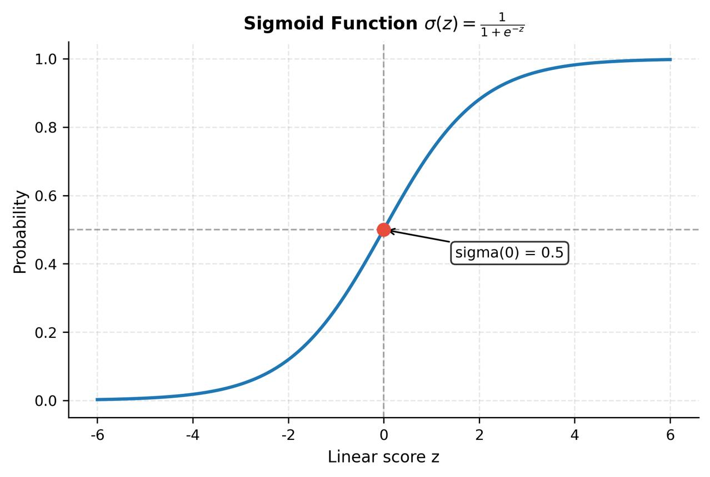

# Logistic Regression

A supervised machine learning algorithm used for classification, not predicting continuous numerical values.

It estimates the probability that an observation belongs to a particular class using the sigmoid function, Log Loss, and gradient descent.

Main concepts:

- Sigmoid function
- Log Loss (loss function)
- Gradient descent
- Learning rate
- L2 regularization

## What is Logistic Regression?

### Supervised Learning: Classification

A supervised machine learning algorithm used to classify observations into categories based on labeled training data.

In other words, it learns from examples to predict which category a new observation belongs to.

Examples:

- Spam or Not Spam
- Fraud or Not Fraud
- Sick or Healthy
- Approved or Rejected

### Why is it called "Regression"?

Although its name contains the word regression, Logistic Regression is primarily used for classification.

It estimates the probability that an observation belongs to a particular class.

For example:

- Class 1: 80% probability.
- Class 0: 20% probability.

The model then uses a decision threshold to assign the final class.

### Linear Regression vs. Logistic Regression

 

## How Does Logistic Regression Work?

Let's use an example with 4 students to understand how the algorithm works.

Imagine we want to predict whether a student will pass an exam based on the number of hours they studied.

### Step 1. Linear Combination

First, the model combines the input features using weights and a bias.

$$z = w_1x_1+w_2x_2+\cdots+w_nx_n+b$$

Where:

- $(x)$: Input features (e.g., study hours).
- $(w)$: Weights that determine the importance of each feature.
- $(b)$: Bias (intercept).
- $(z)$: Linear combination of the inputs.

Just like Linear Regression, this calculation can produce any real number, from negative infinity to positive infinity.

$$-\infty < z < +\infty$$

### Step 2. Sigmoid Function

The sigmoid function converts the linear combination \\(z\\) into a probability between 0 and 1.

$$p = \frac{1}{1+e^{-z}}$$

Where:

- $(z)$: Output of the linear combination.
- $(e)$: Euler's number (approximately 2.718).
- $(p)$: Estimated probability of belonging to class 1.

How does it behave?

| Value of z | Probability     |
| ---------- | --------------- |
| -5         | 0.0067 (0.67%)  |
| -2         | 0.1192 (11.92%) |
| 0          | 0.5000 (50%)    |
| 2          | 0.8808 (88.08%) |
| 5          | 0.9933 (99.33%) |




Key idea: A very negative $(z)$ produces a probability close to 0. A value of $(z=0)$ produces a probability of 0.5. A very positive $(z)$ produces a probability close to 1.

### Step 3. Decision Threshold

The model converts the estimated probability into a predicted class using a threshold.

The default threshold is usually 0.5.

$$\
\hat{y} =
\begin{cases}
1 & \text{if } p \geq 0.5\\
0 & \text{if } p < 0.5
\end{cases}
$$

For example:

| Student   | Probability of passing | Predicted class |
| --------- | ---------------------- | --------------- |
| Student 1 | 0.90 (90%)             | Pass (1)        |
| Student 2 | 0.75 (75%)             | Pass (1)        |
| Student 3 | 0.40 (40%)             | Fail (0)        |
| Student 4 | 0.15 (15%)             | Fail (0)        |


| TPTrue positive  | 3 |
| ---------------- | - |
| FPFalse positive | 3 |
| TNTrue negative  | 2 |
| FNFalse negative | 2 |

$$\text{Precision}=\frac{TP}{TP+FP}=\frac{3}{3+3}=50\\%)$$

$$\text{Recall}=\frac{TP}{TP+FN}=\frac{3}{3+2}=60\\%)$$


## Key Concepts to Understand Next

### 1. Log Loss (Loss Function)

Measures how far the model's predicted probabilities are from the actual labels.

### 2. Gradient Descent

An optimization algorithm that adjusts the model's weights and bias to reduce the loss.

### 3. Learning Rate

Controls how large each adjustment is during gradient descent.

### 4. L2 Regularization

Penalizes excessively large weights to help prevent overfitting and improve generalization.

---

## Sigmoid Function

### 1. What is the sigmoid function?

The sigmoid function transforms any real number, ranging from negative infinity to positive infinity, into a value strictly between 0 and 1.

This makes it useful for converting a model's output (a score) into a probability-like value.

S-shaped curve

- The function has an S-shaped curve.
- It changes rapidly around 0 and becomes flatter toward the extremes.
- This flattening is called saturation.

It never reaches 0 or 1

The sigmoid function approaches 0 as its input approaches negative infinity and approaches 1 as its input approaches positive infinity. However, it never actually reaches either value.

These limits are called horizontal asymptotes.

Mathematically:

$\sigma(z)=\frac{1}{1+e^{-z}}$

Where:

- $(z)$: The input value (any real number).
- $(e)$: Euler's number (approximately 2.71828).
- $(\sigma(z))$: The output of the sigmoid function.

### 2. Where is the sigmoid function used?

Logistic Regression

Converts a linear combination of input features into a probability estimate for the positive class (class 1).

Neural Networks

- Used in the output layer for binary classification, where it produces a value between 0 and 1.
- Previously common in hidden layers, but ReLU is now generally preferred.
- Sigmoid can cause the vanishing gradient problem because its derivative becomes very small at extreme input values. This makes it difficult for earlier layers to learn effectively.

LSTM / GRU Gates

Acts as a soft switch that controls how much information passes through a gate.

Its output ranges from 0 to 1:

- 0: Blocks information.
- 1: Allows information through.
- 0.5: Allows approximately half of the information through.

## 3. Example: Predicting whether students pass or fail

We have four students. We want to predict whether each student passes $(y=1)$ or fails $(y=0)$ based on the number of hours they studied $(x)$.

| Student | Hours studied (x) | Result (y) |
| ------- | ----------------- | ---------- |
| A       | 1                 | 0 (Fail)   |
| B       | 2                 | 0 (Fail)   |
| C       | 4                 | 1 (Pass)   |
| D       | 5                 | 1 (Pass)   |

Our goal is to train a logistic regression model that learns the relationship between study hours and the probability of passing.

## 4. The two parameters

The model learns two parameters:

Weight $(w)$

Controls the slope of the linear function. It determines how strongly the input variable influences the prediction.

Bias $(b)$

Controls the intercept. It shifts the linear function up or down and represents its value when $(x=0)$.

### Step 1: Initialize the parameters

Initially, we set both parameters to zero:

$w=0,\qquad b=0$

The model has not learned anything yet.

Because both parameters are zero, the linear function produces the same output for every student:

$z=0\cdot x+0=0$

Consequently, every student receives the same initial probability: 0.5.

### Step 2: Make predictions

This is where the sigmoid function comes in.

First: Calculate the linear output

$z=w\cdot x+b$

This is the linear component of logistic regression, also called the logit or linear score.

Second: Convert the linear output into a probability

$p=\sigma(z)=\frac{1}{1+e^{-z}}$

The sigmoid function transforms the linear score into a value between 0 and 1.

Initial predictions

Using $(w=0)$ and $(b=0)$:

| Student | x | y | Linear output (z) | Probability (p) |
| ------- | - | - | ----------------- | --------------- |
| A       | 1 | 0 | 0                 | 0.50            |
| B       | 2 | 0 | 0                 | 0.50            |
| C       | 4 | 1 | 0                 | 0.50            |
| D       | 5 | 1 | 0                 | 0.50            |

For every student:

1. Calculate $(z=w\cdot x+b)$.
2. Since both parameters are zero, $(z=0)$.
3. Apply the sigmoid function: $(\sigma(0)=0.5)$.

The model initially predicts a 50% probability of passing for everyone.

Python implementation:

```python
import math

def sigmoid(z):
    return 1 / (1 + math.exp(-z))

sigmoid(0)  # 0.5
```

### Step 3: Measure the prediction error (Log Loss)

Now that we have predictions, we need to measure how far they are from the actual results.

This is where Log Loss, also known as Binary Cross-Entropy, comes in.

It measures how well the predicted probabilities match the actual binary labels.

The Log Loss formula:

$L=-[y\cdot\ln(p)+(1-y)\cdot\ln(1-p)]$

Where:

- $(y)$: Actual label (0 or 1).
- $(p)$: Predicted probability of belonging to class 1.
- $(\ln)$: Natural logarithm.

How does it work?

When the actual result is $(y=1)$ (Pass):

$L=-\ln(p)$

It penalizes predictions with low probabilities of passing.

When the actual result is $(y=0)$ (Fail):

$L=-\ln(1-p)$

It penalizes predictions with high probabilities of passing.

Examples:

```python
import math

def log_loss(y, p):
    return -(y * math.log(p) + (1 - y) * math.log(1 - p))

-math.log(1)    # 0.0
-math.log(0.1)  # 2.3026
```

A lower Log Loss means better predictions. A higher Log Loss means worse predictions.

Calculate the initial loss

Since all four students have a predicted probability of 0.5:

For students A and B $(y=0)$:

$L=-\ln(1-0.5)=0.693$

For students C and D $(y=1)$:

$L=-\ln(0.5)=0.693$

The average loss is:

$L\_{\text{avg}}=\frac{0.693+0.693+0.693+0.693}{4}$

$\boxed{L\_{\text{avg}}=0.693}$

This is our initial error. The model will try to minimize it during training.

## 5. Why use Log Loss instead of MSE?

Both Mean Squared Error (MSE) and Log Loss measure prediction errors, but they behave differently when used with logistic regression.

Mean Squared Error (MSE)

$MSE=\frac{1}{n}\sum\_{i=1}^{n}(y_i-p_i)^2$

MSE measures the average squared difference between actual labels and predicted probabilities.

However, when combined with the sigmoid function, its optimization surface can have flatter regions and gradients that become very small. This can make gradient-based optimization slower or less effective.

Log Loss (Binary Cross-Entropy)

$L=-\frac{1}{n}\sum\_{i=1}^{n} [y_i\ln(p_i)+(1-y_i)\ln(1-p_i)]$

Log Loss is particularly well suited to probabilistic binary classification.

For logistic regression, it produces a convex optimization objective (when the model is linear in its parameters). This means there are no problematic local minima: every local minimum is also a global minimum.

Important distinction: Log Loss does not guarantee a unique minimum in every situation. That depends on the dataset and model.

| Feature                                   | MSE                         | Log Loss                                |
| ----------------------------------------- | --------------------------- | --------------------------------------- |
| Measures                                  | Squared prediction error    | Probability prediction error            |
| Main use                                  | Regression                  | Classification                          |
| Penalizes confident incorrect predictions | Yes                         | Very strongly                           |
| Optimization with sigmoid                 | Can have non-convex regions | Convex for standard logistic regression |
| Common choice for logistic regression     | Less common                 | Standard choice                         |

Key idea: Log Loss is preferred in logistic regression because it evaluates predicted probabilities effectively and provides a well-behaved optimization objective for learning the model's parameters.

---

## Gradient Descent

Gradient Descent is a general optimization algorithm used in Machine Learning to find the optimal model parameters by iteratively minimizing a cost function (or loss function).

Its main purpose is to adjust a model's parameters (θ), such as weights and biases, to reduce prediction errors and improve model performance.

### 1. The Basic Principle: The Mountain Analogy

Imagine you are lost in the mountains on a foggy day. You cannot see your surroundings, but you can feel the slope of the ground beneath your feet.

To reach the bottom of the valley, you repeatedly take steps in the direction of the steepest downward slope.

In Machine Learning:

- The mountain: Represents the cost function.
- Your position: Represents the current values of the model parameters.
- The slope: Represents the gradient of the cost function.
- The bottom of the valley: Represents the minimum value of the cost function.
- Each step: Represents an update to the model parameters.

The goal is to reach the lowest possible point, where the model's cost is minimized.

### 2. The Mathematical Update Rule

Gradient Descent calculates the gradient of the cost function with respect to the model parameters and updates them in the opposite direction.

The mathematical formula is:

$$\theta_{\text{next}} = \theta - \eta \nabla\_{\theta}J(\theta)$$

Where:

- θ (Theta): The vector containing the model's parameters, such as weights and biases.
- η (Learning Rate): A hyperparameter that controls the size of each update.
  - Too small: Training becomes very slow because the algorithm takes tiny steps.
  - Too large: The algorithm may overshoot the minimum, oscillate, or even diverge.
- ∇θJ(θ) (Gradient): A vector containing the partial derivatives of the cost function with respect to each model parameter. It indicates the direction of the steepest increase in cost.

By subtracting the gradient, the algorithm moves toward a lower cost.

### 3. The Three Main Types of Gradient Descent

The three main variants differ in how much training data they use to calculate the gradient at each iteration.

| Variant                           | How it works                                                                 | Advantages                                                                                                          | Disadvantages                                           |
| --------------------------------- | ---------------------------------------------------------------------------- | ------------------------------------------------------------------------------------------------------------------- | ------------------------------------------------------- |
| Batch Gradient Descent            | Uses the entire training dataset to calculate each gradient update.          | Stable and consistent updates; converges smoothly for convex problems.                                              | Computationally expensive for large datasets.           |
| Stochastic Gradient Descent (SGD) | Uses one randomly selected training instance per update.                     | Fast updates, low memory requirements, and noisy steps that can help escape shallow local minima or saddle regions. | Updates are noisy and may fluctuate around the minimum. |
| Mini-batch Gradient Descent       | Uses a small subset of randomly selected training instances for each update. | Balances computational efficiency and update stability; takes advantage of GPU and TPU parallel processing.         | Requires choosing an appropriate batch size.            |

### 4. Important Technical Considerations

Three important factors influence how effectively Gradient Descent works.

Feature Scaling

When features have significantly different numerical ranges, the cost function can become elongated rather than having a balanced shape.

This causes Gradient Descent to take inefficient zigzagging steps, slowing down convergence.

Feature scaling techniques such as `StandardScaler` or `MinMaxScaler` from Scikit-Learn help bring features to comparable numerical ranges.

Convexity

A convex cost function has no local minima other than its global minimum.

For example, in ordinary Linear Regression, the Mean Squared Error (MSE) cost function is convex with respect to the model parameters.

This means Gradient Descent can theoretically find the global minimum, provided the optimization conditions are appropriate.

However, not all Machine Learning models have convex cost functions. Neural networks, for example, typically have non-convex loss landscapes.

Learning Rate Schedule

A learning rate schedule gradually adjusts the learning rate during training.

For example, the algorithm can start with a relatively large learning rate to make faster progress and gradually reduce it to take smaller, more precise steps.

This helps reduce fluctuations near a minimum and improves convergence stability.

### 5. Key Differences to Remember

| Concept         | Meaning                                                                 |
| --------------- | ----------------------------------------------------------------------- |
| Cost Function   | Measures how wrong the model's predictions are.                         |
| Gradient        | Indicates the direction and magnitude of the steepest increase in cost. |
| Learning Rate   | Determines how large each parameter update is.                          |
| Epoch           | One complete pass through the entire training dataset.                  |
| Iteration       | One parameter update.                                                   |
| Batch Size      | Number of training instances used to calculate one gradient update.     |
| Convergence     | The process of approaching a stable minimum of the cost function.       |
| Feature Scaling | Adjusting feature ranges to improve optimization efficiency.            |

### 6. Example: Predicting Whether Students Pass or Fail

Imagine we have four students. We want to predict whether they will pass an exam based on the number of hours they studied.

| Student | Hours Studied (x) | Actual Result (y) |
| ------- | ----------------- | ----------------- |
| A       | 1                 | 0 (Fail)          |
| B       | 2                 | 0 (Fail)          |
| C       | 4                 | 1 (Pass)          |
| D       | 5                 | 1 (Pass)          |

Initially, the model makes predictions using random or initial weights and biases. Gradient Descent calculates the prediction error and adjusts these parameters to reduce the Log Loss.

After several iterations, the model learns that students who study more hours are more likely to pass.

Key idea: Gradient Descent repeatedly adjusts the model's weights and bias to minimize prediction errors and improve its predictions.

---

## The Optimizer in Practice

### 1. The Optimization Cycle

Logistic Regression follows an iterative process to improve its predictions. The model repeatedly performs four steps:

Step 1. Predict using the sigmoid function

Convert the model's linear output into a probability between 0 and 1.

$$p = \sigma(w \cdot x + b)$$

Step 2. Measure the error (Log Loss)

Compare the predicted probability with the actual label to measure how wrong the prediction is.

$$L = -[y\ln(p)+(1-y)\ln(1-p)]$$

Step 3. Calculate the gradient

Calculate how much each parameter (weight and bias) contributes to the loss and in which direction it should change.

For a single feature, the gradient with respect to the weight is:

$$\frac{\partial L}{\partial w}=(p-y)x$$

For the bias:

$$\frac{\partial L}{\partial b}=p-y$$

For multiple training observations, these gradients are averaged across the dataset.

Step 4. Update the parameters

Adjust the weights and bias in the opposite direction of the gradient to reduce the loss.

$$w = w - \alpha \cdot \text{gradient}$$

Where:

- $(w)$: Current weight.
- $(\alpha)$: Learning rate, which controls the size of each update.
- Gradient: Indicates how the loss changes when the parameter changes.

### 2. What Is Gradient Descent?

The process we performed manually is called Gradient Descent.

It is an optimization algorithm that repeatedly adjusts a model's weights and bias to minimize its loss function.

The easiest way to understand it is through four actions:

1. Predict: Make a prediction using the current parameters.
2. Measure: Calculate how far the prediction is from the actual result.
3. Calculate: Determine the gradient (the direction and magnitude of the steepest increase in loss).
4. Update: Move the parameters in the opposite direction to reduce the loss.

### 3. How Does Scikit-Learn Optimize Logistic Regression?

When we use Scikit-Learn's `LogisticRegression`, we don't need to implement Gradient Descent manually.

By default, Scikit-Learn uses an optimization algorithm called L-BFGS (Limited-memory Broyden–Fletcher–Goldfarb–Shanno).

Unlike basic Gradient Descent, L-BFGS uses information from previous iterations to approximate the curvature of the loss function (how the surface bends).

This helps it choose more informed parameter updates and often converge in fewer iterations.

Key difference:

- Gradient Descent: Uses the gradient (slope) to determine how to update the parameters.
- L-BFGS: Uses gradient information and an approximation of the curvature to determine more informed updates.

Both methods aim to minimize the loss function by finding suitable values for the model's weights and bias.

### 4. Python Implementation

```python
from sklearn.linear_model import LogisticRegression

model = LogisticRegression()

# Default configuration:
# solver="lbfgs"
# penalty="l2"
```

Important parameters:

| Parameter        | Meaning                                                          |
| ---------------- | ---------------------------------------------------------------- |
| `solver="lbfgs"` | Uses the L-BFGS optimization algorithm.                          |
| `penalty="l2"`   | Applies L2 regularization to penalize excessively large weights. |

Key idea: Gradient Descent helps us understand the fundamental optimization process. Scikit-Learn uses more sophisticated optimization algorithms, such as L-BFGS, to learn the model parameters efficiently.