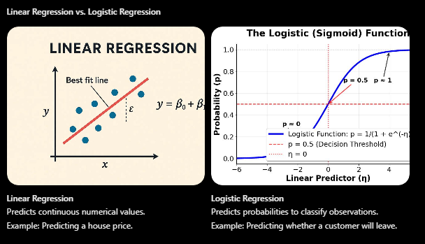

# Logistic Regression

A supervised machine learning algorithm used for classification, not predicting continuous numerical values.

It estimates the probability that an observation belongs to a particular class using the sigmoid function, Log Loss, and gradient descent.

Main concepts:

- Sigmoid function
- Log Loss (loss function)
- Gradient descent
- Learning rate
- L2 regularization

## What is Logistic Regression?

### Supervised Learning: Classification

A supervised machine learning algorithm used to classify observations into categories based on labeled training data.

In other words, it learns from examples to predict which category a new observation belongs to.

Examples:

- Spam or Not Spam
- Fraud or Not Fraud
- Sick or Healthy
- Approved or Rejected

### Why is it called "Regression"?

Although its name contains the word regression, Logistic Regression is primarily used for classification.

It estimates the probability that an observation belongs to a particular class.

For example:

- Class 1: 80% probability.
- Class 0: 20% probability.

The model then uses a decision threshold to assign the final class.

### Linear Regression vs. Logistic Regression

 

## How Does Logistic Regression Work?

Let's use an example with 4 students to understand how the algorithm works.

Imagine we want to predict whether a student will pass an exam based on the number of hours they studied.

### Step 1. Linear Combination

First, the model combines the input features using weights and a bias.

$$z = w_1x_1+w_2x_2+\cdots+w_nx_n+b$$

Where:

- $(x)$: Input features (e.g., study hours).
- $(w)$: Weights that determine the importance of each feature.
- $(b)$: Bias (intercept).
- $(z)$: Linear combination of the inputs.

Just like Linear Regression, this calculation can produce any real number, from negative infinity to positive infinity.

$$-\infty < z < +\infty$$

### Step 2. Sigmoid Function

The sigmoid function converts the linear combination \\(z\\) into a probability between 0 and 1.

$$p = \frac{1}{1+e^{-z}}$$

Where:

- $(z)$: Output of the linear combination.
- $(e)$: Euler's number (approximately 2.718).
- $(p)$: Estimated probability of belonging to class 1.

How does it behave?

| Value of z | Probability     |
| ---------- | --------------- |
| -5         | 0.0067 (0.67%)  |
| -2         | 0.1192 (11.92%) |
| 0          | 0.5000 (50%)    |
| 2          | 0.8808 (88.08%) |
| 5          | 0.9933 (99.33%) |

[Linear Classifiers: Decision Boundaries and Logistic Regression - Interactive | Michael Brenndoerfer | Michael Brenndoerfer](https://images.openai.com/static-rsc-4/UgiJxOABrZVBPOPej7rNppnWQ8EyX9gnDHGBUesuE-ZoEGOt8w1oAMNE6rCZzxnK5ktUMxyOUNtblLcX53q2IbF6YrL1nziT44hQQw41brHnPTBn_cQaPHanhQY4BmSD67SFdOo4FJ0fQU5OZ_R5wVlJMmNtQMA-id43KTsNPkY?purpose=inline)

[mbrenndoerfer.com](https://mbrenndoerfer.com/writing/linear-classifiers-neural-network-foundations?utm_source=chatgpt.com)

Key idea: A very negative \\(z\\) produces a probability close to 0. A value of \\(z=0\\) produces a probability of 0.5. A very positive \\(z\\) produces a probability close to 1.

### Step 3. Decision Threshold

The model converts the estimated probability into a predicted class using a threshold.

The default threshold is usually 0.5.

$$\
\hat{y} =
\begin{cases}
1 & \text{if } p \geq 0.5\\
0 & \text{if } p < 0.5
\end{cases}
$$

For example:

| Student   | Probability of passing | Predicted class |
| --------- | ---------------------- | --------------- |
| Student 1 | 0.90 (90%)             | Pass (1)        |
| Student 2 | 0.75 (75%)             | Pass (1)        |
| Student 3 | 0.40 (40%)             | Fail (0)        |
| Student 4 | 0.15 (15%)             | Fail (0)        |

| TPTrue positive  | 3 |
| ---------------- | - |
| FPFalse positive | 3 |
| TNTrue negative  | 2 |
| FNFalse negative | 2 |

$$\text{Precision}=\frac{TP}{TP+FP}=\frac{3}{3+3}=50\\%)$$

$$\text{Recall}=\frac{TP}{TP+FN}=\frac{3}{3+2}=60\\%)$$

## Key Concepts to Understand Next

### 1. Log Loss (Loss Function)

Measures how far the model's predicted probabilities are from the actual labels.

### 2. Gradient Descent

An optimization algorithm that adjusts the model's weights and bias to reduce the loss.

### 3. Learning Rate

Controls how large each adjustment is during gradient descent.

### 4. L2 Regularization

Penalizes excessively large weights to help prevent overfitting and improve generalization.

---

