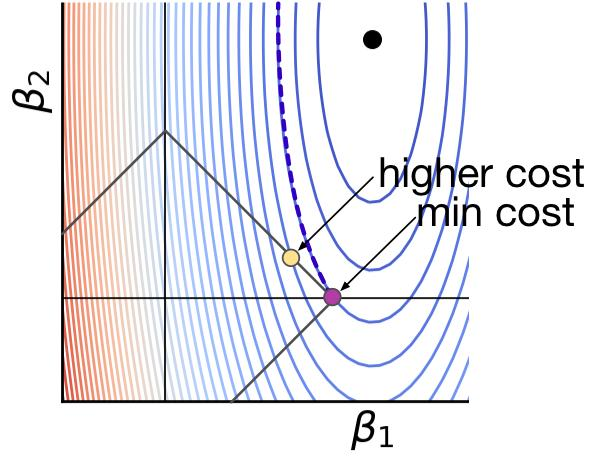
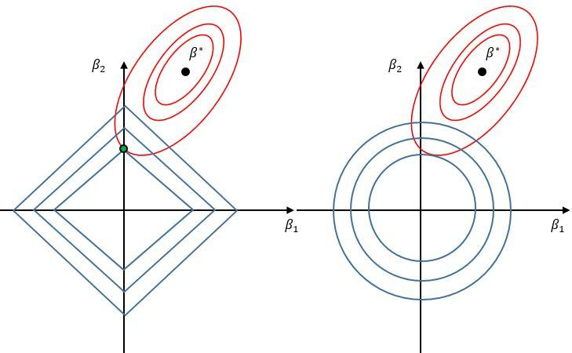
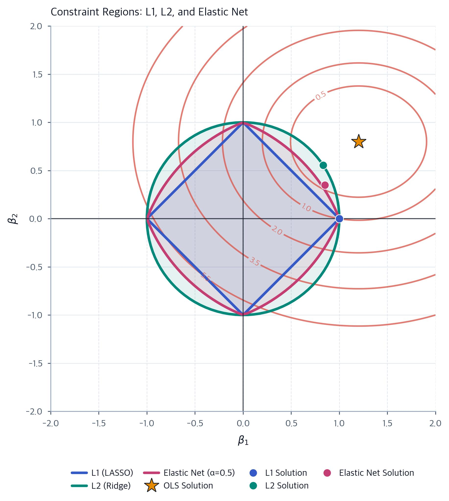

# Elastic Net Regression

Elastic Net = Lasso (L1) + Ridge (L2)

Elastic Net combines the strengths of Lasso and Ridge regression in a single cost function. It can eliminate unimportant variables by setting their coefficients to zero while also reducing the size of the remaining coefficients to help prevent overfitting.

## What is Elastic Net Regression?

Elastic Net is a type of regularized linear regression that combines L1 regularization (Lasso) and L2 regularization (Ridge) to control model complexity and improve prediction performance.

### Cost function

$\begin{aligned} J(\boldsymbol{\beta}) ={}& \underbrace{\frac{1}{2n}\sum\_{i=1}^{n} (y_i-\hat y_i)^2}\ _{\text{Squared error}}\\\ &+\underbrace{\lambda\alpha \sum\_{j=1}^{p}|\beta_j|}\ _{\text{L1 penalty}}\\\ &+\underbrace{\frac{\lambda(1-\alpha)}{2} \sum\_{j=1}^{p}\beta_j^2}\ _{\text{L2 penalty}} \end{aligned}$

Where:

- $(J(\boldsymbol{\beta}))$: The total cost that the model tries to minimize.
- $(n)$: The number of observations in the dataset.
- $(p)$: The number of predictor variables.
- $(y_i)$: The actual target value for observation (i).
- $(\hat y_i)$: The predicted target value for observation (i).
- $(\beta_j)$: The coefficient of predictor (j).
- $(\frac{1}{2n}\sum (y_i-\hat y_i)^2)$: The squared-error term, which measures how far the predictions are from the actual values.
- $(\lambda)$: The overall regularization strength. A larger value applies stronger penalties to the coefficients.
- $(\alpha)$: The mixing parameter, between 0 and 1, that controls the balance between Lasso and Ridge.
- $(\lambda\alpha\sum|\beta_j|)$: The L1 penalty, which can force some coefficients to become exactly zero.
- $(\frac{\lambda(1-\alpha)}{2}\sum\beta_j^2)$: The L2 penalty, which shrinks coefficients toward zero without generally making them exactly zero.

Note: This is one common formulation of the Elastic Net cost function. The exact scaling of the terms may vary between implementations.

## What each part contributes

### 1. L1 regularization — Lasso

L1 regularization can set coefficients exactly to zero, effectively removing the corresponding predictors from the model. This makes Lasso useful for automatic feature selection.



- Geometric shape: A diamond-shaped constraint region in two dimensions, with sharp corners along the coordinate axes.
- Why it eliminates variables: The minimum-cost solution can occur at a corner or edge where one or more coefficients are exactly zero.
- Main benefit: Produces simpler models by selecting a subset of predictors.

### 2. L2 regularization — Ridge

L2 regularization reduces the magnitude of coefficients without generally setting them exactly to zero. It also helps stabilize the model when predictors are highly correlated.



- Geometric shape: A smooth, circular constraint region in two dimensions, or a sphere in higher dimensions.
- Why it shrinks coefficients: The squared-coefficient penalty discourages large coefficient values.
- Main benefit: Reduces overfitting and helps stabilize coefficient estimates, especially when predictors are highly correlated.

### 3. Elastic Net — L1 and L2 combined

Elastic Net combines the variable-selection ability of Lasso with the coefficient-shrinkage and stability benefits of Ridge.



- Geometric shape: A compromise between the sharp corners of L1 and the smooth curvature of L2.
- Why it is useful: The L1 component can set coefficients to zero, while the L2 component encourages correlated predictors to share influence rather than forcing the model to select just one.
- Main benefit: Performs feature selection while often providing more stable results than Lasso alone.

### Understanding the mixing parameter

In the formula above, $(\alpha)$ controls the balance between the two penalties.

| Value of $(\alpha)$ | Model       | Effect                                                                       |
| --------------------- | ----------- | ---------------------------------------------------------------------------- |
| $(1)$               | Lasso       | L1 penalty only                                                              |
| $(0)$               | Ridge       | L2 penalty only                                                              |
| $(0.5)$             | Elastic Net | Equal weighting of L1 and L2 penalty terms, subject to the formula's scaling |

The value $(\alpha=0.5)$ gives equal weighting to the two penalty components, but it does not necessarily make their practical effects equal.

Important distinction: The mixing parameter $(\alpha)$ is not the same as the overall regularization strength $(\lambda)$. The parameter $(\alpha)$ determines the type of regularization, while $(\lambda)$ determines how strongly regularization is applied.

## Why does Elastic Net exist?

Lasso has two important limitations that Elastic Net helps address.

### 1. Highly correlated predictors

When several predictors are strongly correlated, they provide similar information. Lasso tends to select one predictor from such a group and set the coefficients of the others to zero. Which predictor it selects can be unstable across different datasets.

How Elastic Net helps: Its L2 penalty encourages correlated predictors to remain together in the model more often, producing more stable feature selection. However, it does not guarantee that every correlated predictor will be retained.

### 2. More predictors than observations $(p>n)$

When the number of predictors exceeds the number of observations, Lasso can select at most $(n)$ predictors with nonzero coefficients under the standard formulation. This can limit its flexibility when working with high-dimensional data.

How Elastic Net helps: The L2 component relaxes this limitation, allowing Elastic Net to retain more than $(n)$ predictors with nonzero coefficients when appropriate. This can be useful in datasets with many predictors and relatively few observations.

---

## What are $(p)$ and $(n)$? (Simulated data)

- $(p)$: The number of predictor variables (features or input columns) used to predict the target.
- $(n)$: The number of observations (samples or rows) in the dataset.

For example, suppose we want to predict house prices using five features: square meters, bedrooms, bathrooms, age, and distance from the city center.

| House   | Area (m²) | Bedrooms | Bathrooms | Age | Distance from center | Price |
| ------- | --------- | -------- | --------- | --- | -------------------- | ----- |
| House 1 | 132       | 4        | 3         | 4   | 11.7 km              | 571   |
| House 2 | 93        | 3        | 2         | 16  | 12.2 km              | 348   |
| House 3 | 127       | 4        | 3         | 24  | 12.8 km              | 470   |

In this dataset:

- $(p=5)$: Five predictor variables.
- $(n=3)$: Three observations (houses).
- The target variable is `price`. It is not counted in $(p)$.

Therefore, $p>n$, because $5>3$. There are more predictor variables than observations.

## Why is this a problem for Lasso?

Suppose Lasso produces the following coefficients:

| Predictor            | Coefficient |
| -------------------- | ----------- |
| Area                 | +0.78       |
| Bedrooms             | 0           |
| Bathrooms            | 0           |
| Age                  | −0.27       |
| Distance from center | 0           |

Lasso has retained two predictors and eliminated the other three by setting their coefficients to zero.

Under the standard Lasso formulation, when $(p>n)$, the number of nonzero coefficients is at most $(n)$. Therefore, with three observations, Lasso can retain at most three predictors under the usual assumptions.

When an intercept is included, the tighter bound is often $(n-1)$. In this example, that gives:

$n-1=3-1=2$

This explains why a solution with two nonzero coefficients is possible. However, the exact bound depends on the formulation, the data, and the assumptions; Lasso does not necessarily retain exactly $(n-1)$ predictors.

Important: This limitation does not mean Lasso identifies the truly important predictors. It means the mathematical structure of the problem can restrict how many predictors receive nonzero coefficients.

## How does Elastic Net help?

Elastic Net combines L1 regularization (Lasso) with L2 regularization (Ridge). The L1 component can eliminate predictors, while the L2 component can make coefficient estimates more stable, especially when predictors are highly correlated.

Consider the same dataset with five predictors and three observations.

Suppose Elastic Net produces these illustrative coefficients:

| Predictor            | Lasso coefficient | Elastic Net coefficient |
| -------------------- | ----------------- | ----------------------- |
| Area                 | +0.78             | +0.52                   |
| Bedrooms             | 0                 | +0.18                   |
| Bathrooms            | 0                 | +0.12                   |
| Age                  | −0.27             | −0.21                   |
| Distance from center | 0                 | −0.09                   |

These numbers are illustrative, not calculated from the dataset.

In this example:

- Lasso retains two predictors and sets the other coefficients to zero.
- Elastic Net retains all five predictors with nonzero coefficients, while shrinking their magnitudes.

Unlike Lasso, Elastic Net can retain more than $(n)$ predictors with nonzero coefficients, making it useful when the dataset has many predictors but few observations.

### Why is this useful when predictors are correlated?

Imagine that `area`, `bedrooms`, and `bathrooms` are strongly correlated: larger houses often have more bedrooms and bathrooms.

- Lasso may select `area` and eliminate `bedrooms` and `bathrooms`.
- Elastic Net may distribute the predictive contribution across these related variables, retaining several of them with smaller coefficients.

Elastic Net does not guarantee that correlated predictors will always be selected together. Rather, the L2 penalty encourages more stable behavior across groups of correlated predictors.

The key idea: Lasso favors sparse models with fewer selected predictors. Elastic Net preserves this feature-selection ability while allowing more predictors to remain in the model when the L2 component makes that beneficial.

---

## In scikit-learn: Two Main Parameters

In scikit-learn, `ElasticNet` and `ElasticNetCV` use two main hyperparameters: `alpha` and `l1_ratio`.

### 1. `alpha`: Overall regularization strength

`alpha` controls how strongly the model penalizes large coefficients.

- Larger `alpha`: Stronger regularization, so coefficients tend to shrink more. More coefficients may become zero.
- Smaller `alpha`: Weaker regularization, so the model fits the training data more freely.
- `alpha = 0`: No regularization. Scikit-learn recommends using `LinearRegression` instead of `ElasticNet` in this case.

Important: `alpha` in Elastic Net is not directly comparable to `alpha` in Ridge regression because their objective functions use different parameterizations.

### 2. `l1_ratio`: Balance between L1 and L2

`l1_ratio` determines how the regularization is divided between Lasso (L1) and Ridge (L2).

| `l1_ratio` | Regularization | Effect                                                      |
| ---------- | -------------- | ----------------------------------------------------------- |
| `0`        | Ridge (L2)     | Shrinks coefficients without generally setting them to zero |
| `0.5`      | Elastic Net    | Combines L1 and L2 penalties                                |
| `1`        | Lasso (L1)     | Can set coefficients exactly to zero                        |

For values between 0 and 1, Elastic Net combines both penalties.

The overall regularization strength is controlled by `alpha`, while `l1_ratio` controls the balance between L1 and L2.

## Practical tips

### 1. Standardize your features

Standardization is generally recommended before training Elastic Net because the penalty depends on coefficient magnitudes, which are affected by feature scales.

For example, house area might be measured in square meters, while distance might be measured in kilometers. Without standardization, differences in scale can cause the regularization penalty to affect the predictors unevenly.

`StandardScaler()` transforms each feature to have a mean of approximately 0 and a standard deviation of approximately 1.

Using a scikit-learn `Pipeline` ensures that the scaler is fitted on the training data during cross-validation, helping prevent data leakage.

### 2. Tune `alpha` and `l1_ratio` using cross-validation

The best hyperparameter values depend on the dataset. Rather than choosing them arbitrarily, use cross-validation to compare different combinations and select the ones that perform best on held-out folds.

`ElasticNetCV` automates this process by testing candidate values and selecting the best combination according to its cross-validation procedure.

## Example in Python

```python
from sklearn.linear_model import ElasticNetCV
from sklearn.preprocessing import StandardScaler
from sklearn.pipeline import make_pipeline

model = make_pipeline(
    StandardScaler(),
    ElasticNetCV(
        l1_ratio=[0.1, 0.5, 0.7, 0.9, 0.95, 1.0],
        cv=5
    )
)

model.fit(X_train, y_train)

# Access the fitted ElasticNetCV model
enet = model[-1]

# Print the selected hyperparameters
print("Best alpha:", enet.alpha_)
print("Best l1_ratio:", enet.l1_ratio_)

# Count predictors whose coefficients are exactly zero
print((enet.coef_ == 0).sum(), "features discarded")
```

### What does the code do?

1. `StandardScaler()` standardizes the input features.
2. `ElasticNetCV(...)` tests the specified `l1_ratio` values and selects the best combination of `alpha` and `l1_ratio` using five-fold cross-validation.
3. `model.fit(X_train, y_train)` fits the pipeline and performs hyperparameter selection.
4. `model[-1]` retrieves the fitted `ElasticNetCV` estimator from the pipeline.
5. `enet.alpha_` returns the selected regularization strength.
6. `enet.l1_ratio_` returns the selected L1/L2 balance.
7. `(enet.coef_ == 0).sum()` counts the predictors whose fitted coefficients are exactly zero.

Note: With five-fold cross-validation, the training dataset must contain enough samples for each fold. Also, `ElasticNetCV` searches over its default grid of `alpha` values unless you explicitly provide an `alphas` grid. The example tunes `l1_ratio` over the listed candidates and `alpha` over the estimator's automatically generated candidates.

---

## Example: 300 Simulated Houses and 7 Variables

### Why are some variables highly correlated?

Square meters, number of bedrooms, and number of bathrooms often measure related aspects of a house's size. Larger houses tend to have more bedrooms and bathrooms, so these variables may be strongly positively correlated.

A correlation matrix helps us identify these relationships by showing how strongly each pair of variables is linearly related. Correlations range from $(-1)$ to $(+1)$:

- Close to $(+1)$: Strong positive relationship. The variables tend to increase together.
- Close to $(-1)$: Strong negative relationship. As one variable increases, the other tends to decrease.
- Close to $(0)$: Little or no linear relationship.

[Code Example 300 Simulated](../../Example300Simulated.ipynb)

## Elastic Net with Increasing `alpha`

Simulated data: 300 houses, 7 predictor variables, with both features and target standardized; `l1_ratio = 0.5`.

As `alpha` increases, the regularization becomes stronger. The model increasingly penalizes large coefficients, causing them to shrink toward zero. Some coefficients may eventually become exactly zero, meaning their corresponding variables are excluded from the model.

### 1. How to interpret the coefficients

Because the features and target (`price`) are standardized, each coefficient represents the predicted change in price, measured in standard deviations, when that feature increases by one standard deviation, holding the other features constant.

For example, a coefficient of $(0.6)$ means that a one-standard-deviation increase in that feature is associated with a predicted increase of $(0.6)$ standard deviations in price, holding the other predictors constant.

Standardization makes coefficient magnitudes more comparable across features, although strong correlations can make their individual contributions difficult to interpret.

### 2. What happens as `alpha` increases?

- Small `alpha`: Regularization is weak, so more coefficients tend to remain nonzero.
- Moderate `alpha`: Coefficients shrink, and some less useful predictors may reach zero.
- Large `alpha`: Regularization is stronger, so more coefficients may become zero. Eventually, the model can underfit if the penalty is too strong.

In this simulated example, the noise variable `num_casa` might be eliminated first, followed by a weaker predictor such as `piso`, while stronger predictors remain.

However, the order in which coefficients become zero is not a reliable ranking of variable importance. It depends on the data, correlations, coefficient magnitudes, and regularization settings. A genuinely useful variable can also be eliminated when its information overlaps with other predictors.

### 3. Why does the correlated group tend to remain together?

Square meters, bedrooms, and bathrooms often provide overlapping information about house size. With `l1_ratio = 0.5`, Elastic Net combines two effects:

- L1 penalty: Encourages sparsity by allowing coefficients to become exactly zero.
- L2 penalty: Encourages correlated predictors to share their influence more evenly and can make coefficient estimates more stable.

As a result, Elastic Net often retains multiple variables from a correlated group rather than selecting only one. This behavior is encouraged by the L2 component, but it is not guaranteed.

## Elastic Net vs. Lasso at the Same `alpha`

Comparison: `alpha = 0.3`, with the same standardized dataset.

Consider the correlated group:

- `square_meters`
- `bedrooms`
- `bathrooms`

| Feature       | Lasso (`l1_ratio = 1`) | Elastic Net (`l1_ratio = 0.5`) |
| ------------- | ---------------------- | ------------------------------ |
| Square meters | Nonzero coefficient    | Nonzero coefficient            |
| Bedrooms      | Zero coefficient       | Nonzero coefficient            |
| Bathrooms     | Zero coefficient       | Nonzero coefficient            |

Illustrative outcome; actual coefficients depend on the simulated data and model fitting.

Lasso may retain square meters while setting bedrooms and bathrooms to zero because square meters already captures much of the same information.

Elastic Net may retain all three because the L2 component encourages correlated predictors to share their contribution, while the L1 component still allows irrelevant predictors to be removed.

This illustrates the key difference: Lasso tends to select individual predictors from correlated groups, whereas Elastic Net is often more likely to retain groups of correlated predictors. Neither method guarantees a particular selection pattern.


---

## Which `alpha` Is Ultimately Used?

The value of `alpha` is not chosen by eye. `ElasticNetCV` tests multiple candidate values of `alpha` and selects the one that performs best according to cross-validation.

The model evaluates how well each candidate generalizes to unseen data and selects the hyperparameter combination with the best average cross-validation score.

If `l1_ratio` is also being tuned, `ElasticNetCV` selects the best combination of `alpha` and `l1_ratio` from the candidate values provided.

## Which Regression Model Should I Use?

### 1. Linear Regression (No Regularization)

Linear Regression minimizes prediction error without penalizing large coefficients.

- When to use it: When regularization is unnecessary and the model's coefficients are sufficiently stable.
- Limitation: It can produce unstable coefficients when predictors are highly correlated and may overfit in some situations.

Regularization is not always necessary. Linear Regression can work very well when the data supports it.

### 2. Ridge Regression (L2) — A Good Starting Point

Ridge shrinks coefficients toward zero but generally does not set them exactly to zero.

- When to use it: When many predictors may contribute to the prediction, especially when they are correlated.
- Main advantage: It reduces coefficient instability and can improve generalization without eliminating predictors.

Ridge is a reasonable starting point when you do not have a strong reason to believe that many predictors are irrelevant.

### 3. Lasso (L1) or Elastic Net — When Feature Selection Matters

Lasso and Elastic Net can set coefficients exactly to zero, automatically removing the corresponding predictors from the model.

- When to use them: When you suspect that some predictors are irrelevant or noisy, such as a variable like `num_houses` that contributes little useful information.
- Main advantage: They can produce simpler models that use fewer predictors.

The choice depends on the data, particularly the number of predictors and how strongly they are correlated.

### 4. Lasso vs. Elastic Net — Which Is Better?

Elastic Net is often preferable when predictors are highly correlated or when there are more predictors than observations $(p>n)$.

- Lasso: May select one predictor from a group of highly correlated variables and set the others to zero.
- Elastic Net: Combines L1 and L2 regularization, making it more likely to retain multiple correlated predictors while still allowing irrelevant predictors to be eliminated.

For example, in a house-price model, square meters, number of bedrooms, and number of bathrooms may all provide useful information about a property's size.

Lasso might retain square meters while eliminating bedrooms and bathrooms. Elastic Net may retain all three because its L2 component encourages correlated predictors to share their contribution.

Practical recommendation: Start with Ridge when you expect many predictors to be useful, consider Lasso when you want a sparse model, and consider Elastic Net when you want feature selection while accounting for correlated predictors. Use cross-validation to compare their predictive performance rather than assuming one model is always best.
