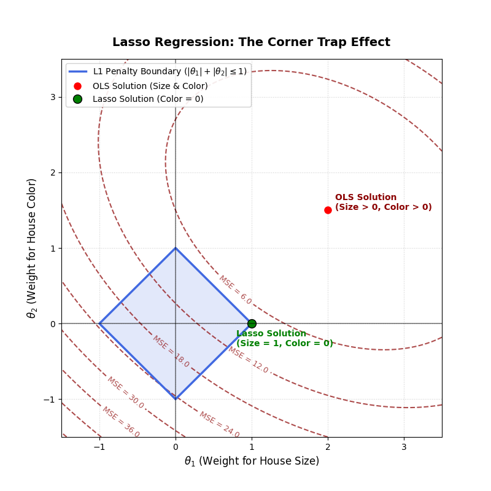

# Lasso Regression (L1 Regularization)

Lasso Regression is a linear regression method that uses an L1 penalty to reduce the size of model coefficients. It can force some coefficients to become exactly zero, effectively removing those features from the model.

- L1 penalty: Adds a penalty based on the sum of the absolute values of the model coefficients.
- Alpha ($\alpha$): Controls the strength of the penalty. A larger alpha applies stronger regularization and may set more coefficients to zero.
- Feature selection: Automatically selects relevant features by setting the coefficients of less useful features to zero.
- 3D geometry: Lasso can be understood geometrically as a constrained optimization problem. In two dimensions, the L1 constraint forms a diamond-shaped region; in three dimensions, it forms an octahedron. The corners encourage some coefficients to become exactly zero.

Key idea: Lasso helps simplify linear models by reducing overfitting and selecting features, especially when some predictors contribute little to the prediction.

---

## The California Housing Problem

### Three features, one of which contributes very little

The model uses three features to predict house prices: size, location, and wall color.

Ordinary linear regression learns a coefficient ($\theta$) for each feature. Even if wall color has little predictive value, its coefficient may still be small but nonzero.

Lasso Regression applies an L1 penalty controlled by the regularization parameter ($\alpha$). As \\($\alpha$\\) increases, the model is encouraged to reduce its coefficients, and some can become exactly zero.

- Size: A feature that strongly influences house prices.
- Location: A feature that strongly influences house prices.
- Wall color: A feature that contributes little to predicting house prices, so Lasso may reduce its coefficient to zero.
- ($\theta$) (coefficient): The weight assigned to a feature, representing how the prediction changes with that feature while the others are held constant.
- ($\alpha$) (regularization strength): Controls how strongly Lasso penalizes large coefficients. A larger value generally encourages more coefficients to become zero.

### How Lasso removes a feature

Initially, all three features may have nonzero coefficients. As ($\alpha$) increases, Lasso adjusts the coefficients to balance prediction accuracy against model complexity.

When ($\alpha = 0.15$), in this example, the coefficient for wall color reaches exactly zero. The model effectively excludes wall color from its predictions while retaining size and location.

Key idea: Lasso performs automatic feature selection by setting some coefficients exactly to zero. The value ($\alpha$ = 0.15) is specific to this example; the actual value depends on the dataset, feature scaling, and implementation.

---


## What is Lasso Regression?

Lasso Regression is a regularization technique for linear regression that adds a penalty to the model to prevent overfitting. It simplifies models by performing feature selection, meaning it drives the coefficients of less important variables exactly to zero.

### Least Absolute Shrinkage and Selection Operator

- Least Absolute (L1 Penalty): Lasso penalizes the absolute values of the coefficients, written as $(\vert{}\theta_j\vert{})$, instead of their squares. Mathematically, the absolute value function creates a sharp "corner" at zero. This geometric property is what allows coefficients to hit zero exactly.
- Shrinkage: Lasso shrinks the model's coefficients toward zero to reduce complexity and control variance. The strength of this effect is controlled by the hyperparameter α. A higher α increases the penalty pressure, shrinking the weights more aggressively.
- Selection: Because the L1 penalty can force coefficients to exactly zero, Lasso acts as an automated feature selection tool. It eliminates irrelevant or redundant variables from the model without requiring manual feature engineering.

### Three Cost Functions: The Key Differences

Linear models change behavior based on how they penalize model complexity.

### 1. Ordinary Least Squares (No Regularization)

$$J(\theta) = \text{MSE}(\theta)$$
Use code with caution.
- Penalty: None.
- Behavior: The model focuses entirely on minimizing training error. Coefficients can grow as large as necessary to fit the data, which often leads to overfitting by memorizing random noise.

### 2. Ridge Regression (L2 Regularization)


$$J(\theta) = \text{MSE}(\theta) + \alpha \sum_{j=1}^{p} \theta_j^2$$
Use code with caution.
- Penalty: Proportional to the square of the coefficients $((\alpha \theta_j^2))$.
- Behavior: Large coefficients face a heavy penalty, while small coefficients near zero cost almost nothing because the penalty curve (a parabola) becomes flat at the bottom. It shrinks all weights close to zero but rarely sets them exactly to zero.

### 3. Lasso Regression (L1 Regularization)

$$J(\theta) = \text{MSE}(\theta) + \alpha \sum_{j=1}^{p} |\theta_j|$$
Use code with caution.
- Penalty: Proportional to the absolute value of the coefficients $((\alpha \vert{}\theta_j\vert{}))$.
- Behavior: It applies a constant penalization pressure regardless of 


---


## Penalized view: "the mountain changes shape"


### A complete example of Lasso Regression using the California Housing dataset

To understand how Lasso changes the cost function landscape, let us predict house prices using two simplified features from the dataset: House Size $(\theta _{1})$ and House Color $(\theta _{2})$.
Imagine the cost function $(J(\theta))$ as a mountain landscape where the lowest point of the valley represents the lowest error (the best model parameters).

### 1. Ordinary Least Squares (No Regularization)

$$J(\theta) = \text{MSE}(\theta)$$
Use code with caution.
- The Mountain Landscape: The shape is determined entirely by the training data. It forms a smooth, elliptical bowl.
- The Result: The valley floor sits at the exact combination of parameters that perfectly minimizes the training error. Because the model wants to squeeze out every drop of performance, it gives a weight to House Size $(\theta _{1})$ and a small, arbitrary weight to House Color $(\theta _{2})$, even though color is just random noise.

### 2. Lasso Regression (L1 Regularization)

$$J(\theta) = \text{MSE}(\theta) + \alpha (|\theta_1| + |\theta_2|)$$
Use code with caution.
- The Mountain Landscape: Adding the L1 penalty deforms the landscape. The penalty acts like a sharp, four-sided pyramid sitting right on top of the origin $(0,0)$. When you add this sharp pyramid to the smooth OLS bowl, the new valley floor gets warped.
- The Corner Trap: The sharp edges and corners of the pyramid pull the lowest point of the valley toward the axes. As you increase $(\alpha)$, the landscape tilts so aggressively that the lowest point gets trapped exactly on the axis line where $(\theta_2 = 0)$.
- The Result: Lasso reshapes the mountain so that the optimal path forces the weight for House Color $(\theta _{2})$ to hit exactly 0, completely dropping it from the model. Meanwhile, the weight for House Size $(\theta _{1})$ is shrunk but kept, because its ability to reduce the MSE outweighs the penalty cost.

---

To visualize how Lasso Regression forces coefficients to zero, we can use the following Python script using matplotlib and numpy.
This code plots the smooth elliptical contours of the Mean Squared Error (MSE) alongside the sharp, diamond-shaped L1 penalty boundary to show why the optimal solution gets trapped on a corner where House Color $(\theta _{2})$ equals 0.

```python
import numpy as np
import matplotlib.pyplot as plt

# 1. Define grid for model weights (theta_1 = Size, theta_2 = Color)
t1 = np.linspace(-1.5, 3.5, 400)
t2 = np.linspace(-1.5, 3.5, 400)
T1, T2 = np.meshgrid(t1, t2)

# 2. Simulate MSE contours centered at the OLS solution (2.0, 1.5)
# The ellipse is rotated/scaled to simulate feature correlation
OLS_t1, OLS_t2 = 2.0, 1.5
MSE = 1.5 * (T1 - OLS_t1)**2 + 2.0 * (T2 - OLS_t2)**2 + 1.2 * (T1 - OLS_t1) * (T2 - OLS_t2)

# 3. Create the plot
plt.figure(figsize=(8, 8))

# Plot MSE contours
contours = plt.contour(T1, T2, MSE, levels=8, colors='darkred', linestyles='dashed', alpha=0.7)
plt.clabel(contours, inline=True, fmt='MSE = %1.1f', fontsize=9)

# Plot the L1 Penalty Boundary (Diamond budget where |theta_1| + |theta_2| <= 1)
diamond_x = [1, 0, -1, 0, 1]
diamond_y = [0, 1, 0, -1, 0]
plt.plot(diamond_x, diamond_y, color='royalblue', linewidth=2.5, label='L1 Penalty Boundary ($|\\theta_1| + |\\theta_2| \\leq 1$)')
plt.fill(diamond_x, diamond_y, color='royalblue', alpha=0.15)

# 4. Highlight key solution points
# OLS solution (overfits, keeps house color noise)
plt.plot(OLS_t1, OLS_t2, 'ro', markersize=8, label='OLS Solution (Size & Color)')
plt.text(OLS_t1 + 0.1, OLS_t2, 'OLS Solution\n(Size > 0, Color > 0)', fontsize=10, weight='bold', color='darkred')

# Lasso solution (hits the top corner of the diamond where theta_2 = 0)
lasso_t1, lasso_t2 = 1.0, 0.0
plt.plot(lasso_t1, lasso_t2, 'go', markersize=10, markeredgecolor='black', label='Lasso Solution (Color = 0)')
plt.text(lasso_t1 - 0.2, lasso_t2 - 0.3, 'Lasso Solution\n(Size = 1, Color = 0)', fontsize=10, weight='bold', color='green')

# 5. Graph formatting
plt.axhline(0, color='black', linewidth=1.2, alpha=0.5)
plt.axvline(0, color='black', linewidth=1.2, alpha=0.5)
plt.grid(True, linestyle=':', alpha=0.6)
plt.title('Lasso Regression: The Corner Trap Effect', fontsize=14, weight='bold', pad=15)
plt.xlabel('$\\theta_1$ (Weight for House Size)', fontsize=12)
plt.ylabel('$\\theta_2$ (Weight for House Color)', fontsize=12)
plt.xlim(-1.5, 3.5)
plt.ylim(-1.5, 3.5)
plt.legend(loc='upper left', framealpha=0.9)

plt.show()
```



How the Code Translates to the Visual Elements:

- The Ellipses (plt.contour): Represent the error penalty landscape. The center is the unregularized path that uses both size and color. As the ellipses expand outward, error increases.
- The Diamond (plt.plot): Represents the L1 geometric budget constraint. Its defining property is having sharp points exactly on the grid axes.
- The Intersection point (1, 0): Shows mathematically that when the growing error ellipse touches the budget region, it meets the protruding corner first. This instantly sets the House Color $(\theta _{2})$ coefficient to zero, executing automatic feature selection.

---


## Choosing $(\alpha )$ via validation: neither too low nor too high

Regularization requires finding the right balance. We tune the hyperparameter $(\alpha )$ by evaluating model performance on a separate validation set using the standard Mean Squared Error (MSE), without the penalty term.

### 1. Small $(\alpha )$: Overfitting

- Behavior: When the penalty is too weak, the model prioritizes minimizing training error above all else. It retains all 20 available variables, assigning weights to random noise and irrelevant features.
- Result: This leads to a low training error but a high validation error because the model fails to generalize to unseen data.

### 2. The Best $(\alpha )$: Minimum Validation Error

- Behavior: At the optimal threshold for example, $(\alpha = 0.39)$ the penalty applies just enough pressure to suppress the noise without destroying genuine signals.
- Result: The model achieves its lowest validation error (e.g., an MSE of 1.50) while compressing the model complexity. It automatically eliminates most of the noise, selecting only the 6 most impactful variables out of 20.

### 3. Large $(\alpha )$: Underfitting

- Behavior: When the penalty is too aggressive, the regularization term dominates the cost function. It suppresses not only the noise but also the highly critical predictive variables.
- Result: Both training and validation errors rise sharply together. As $(\alpha )$ approaches its maximum value $(\alpha _{max})$, every single coefficient is driven to exactly zero, leaving an empty model that predicts only the dataset average.
The L1 penalty is used exclusively during the training phase to guide coefficient estimation. When evaluating model performance on the validation or test sets, we measure standard, unpenalized MSE, exactly as we do with Ridge Regression.

---


## Two Caveats That Always Apply

Regularization introduces specific behavioral traits that require careful data preparation and interpretation.

### 1. Scale Your Variables Beforehand

The regularization penalty treats all coefficients $(\theta _{j})$ equally, regardless of the measurement units of their corresponding features. If you change a feature's unit, its coefficient scale changes inversely, causing Lasso to penalize the exact same underlying information differently.
For example, if you measure house size using different units, the model's weights will vary wildly:
- Size in square meters $(m^{2}): (\theta_1 = 2.0)$
- Size in square centimeters $(cm^{2}): (\theta_1 = 0.0002)$
Because the L1 penalty applies the same pressure directly to the raw magnitude of the weight, the feature with the smaller numerical scale $(cm^{2})$ gets disproportionately squeezed out simply because of its unit of measurement.
Solution: Always standardize your features to have a mean of 0 and a standard deviation of 1 before training. This ensures $(\alpha)$ evaluates every feature on a level playing field—comparing "apples to apples"—exactly as required in Ridge Regression.

### 2. Handling Correlated Variables (Collinearity)

When two or more variables convey nearly identical information (such as a person's age measured in days versus their age in years), Lasso's geometric constraint forces it to choose one variable and drive the other to exactly zero.
Which of the twin features Lasso preserves is highly unstable and can be decided by a literal coin toss of random noise or minor data adjustments:
- Sample Dataset A:
	- Age in days: $(\theta_{\text{days}} = 0.91)$
	- Age in years: $(\theta_{\text{years}} = 0)$
- Sample Dataset B (with just 10% fewer rows):
	- Age in days: $(\theta_{\text{days}} = 0)$
	- Age in years: $(\theta_{\text{years}} = 0.89)$

While both versions yield nearly identical predictions, the specific features selected to remain in the model completely flip.
Interpretation Warning: Never assume a feature is useless or fundamentally unrelated to the target variable simply because Lasso sets its coefficient to \(\theta = 0\). It often means a highly correlated "twin" feature was selected first and already captured the predictive value.

